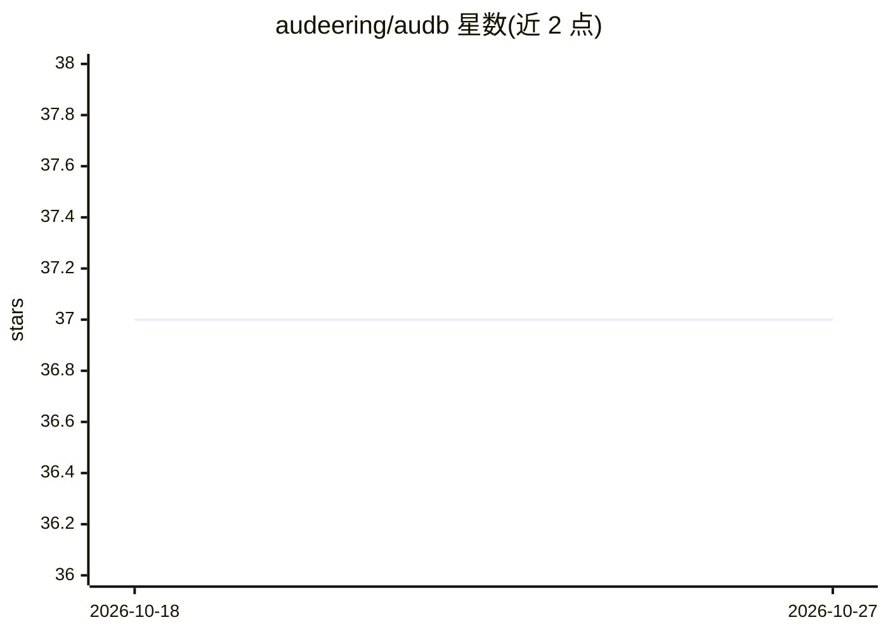

# audeering/audb

⭐ 37 · Python · NOASSERTION · 推送 2026-10-12 · [GitHub](https://github.com/audeering/audb) · [官网](https://audeering.github.io/audb/) · 组织维护

**音频/视频标注数据集的版本管理与分发库**

面向机器学习音频数据集的 Python 管理库：以 audformat 通用格式存储数据库并管理不同版本，支持在本地文件系统、MinIO 或 S3 仓库中存储；下载时可请求重采样或混音处理，并可按条件过滤数据（如仅下载测试集）。定位为数据集的可交换与可复现版本管理，由 audeering 团队维护，附 arXiv 论文与文档。

## 筛选速览

| 维度 | 判定 | 备注 |
|---|---|---|
| AI 角色 | `ai-ecosystem` | LLM/agent 周边工具 |
| 许可风险 | `permissive` | NOASSERTION |
| 部署形态 | `library` | 以包/库形式分发 |
| 模型依赖 | — | README 未给出锁定关系 |
| 硬件要求 | — | 无带数字的原话,不猜 |
| 安装摩擦 | `low` | 无编译、无系统依赖或容器化 |
| 成熟度 | — | 结构信号不足 |

## 能力要点

- 以 audformat 通用格式存储音频与标注数据库
- 支持本地文件系统 / MinIO / S3 存储后端
- 下载时可请求重采样或混音并按条件过滤数据
- 提供数据库版本管理用于可复现性

## 适用场景

- 团队间交换音频标注数据集并保持格式一致
- 为机器学习实验固定数据集版本以保证可复现
- 按需仅下载数据集的特定子集（如测试集）

## 场景标签

`MLOps` · 领域:训练与推理

## 证据(README 行号)

> L5: **audb** manages your annotated media files.
> L7: Databases used in machine learning
> L8: should be easily exchangeable

## 星数曲线

2026-10-18 37 → 2026-10-27 37（+0）

---
*卡片 v1 · prompt 1.4 · 生成 2026-10-25 · 置信度 high · 依据 README sha `95f76d312976` · [字段定义](../../DATASET.md)*
