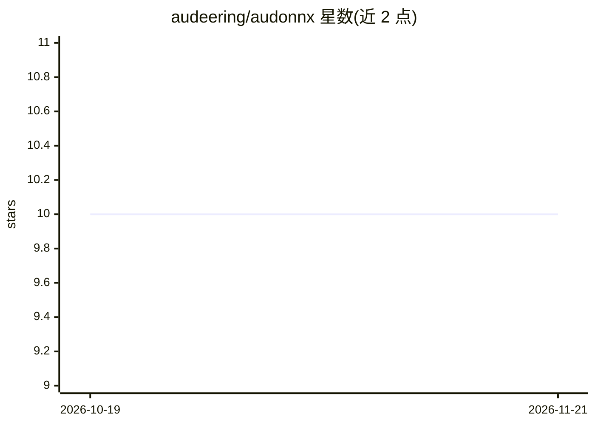

# audeering/audonnx

⭐ 10 · Python · NOASSERTION · 推送 2026-09-15 · [GitHub](https://github.com/audeering/audonnx) · [官网](https://audeering.github.io/audonnx/) · 组织维护

**面向开发者的 ONNX 模型部署 Python 库**

audonnx 是用于部署 ONNX 格式机器学习模型的 Python 库。模型可在 scikit-learn、TensorFlow、Torch 等框架中训练后导出为 ONNX，从而独立于训练框架及其版本，便于部署与组合。库支持对模型输入输出命名，并从随模型存储的 YAML 文件自动加载对应的特征提取。安装与使用说明位于文档站点，包通过 PyPI 发布，采用 MIT 许可。

## 筛选速览

| 维度 | 判定 | 备注 |
|---|---|---|
| AI 角色 | `ai-ecosystem` | LLM/agent 周边工具 |
| 许可风险 | `permissive` | NOASSERTION |
| 部署形态 | `library` | 以包/库形式分发 |
| 模型依赖 | — | README 未给出锁定关系 |
| 硬件要求 | — | 无带数字的原话,不猜 |
| 安装摩擦 | `low` | 无编译、无系统依赖或容器化 |
| 成熟度 | — | 结构信号不足 |

## 能力要点

- 加载并运行 ONNX 格式模型，独立于训练框架
- 支持为模型输入输出命名
- 从随模型存储的 YAML 文件自动加载特征提取

## 适用场景

- 把其他框架训练的模型导出为 ONNX 后部署
- 组合多个 ONNX 模型进行推理
- 按模型包内 YAML 配置自动完成特征提取

## 场景标签

`推理引擎` · 领域:训练与推理

## 证据(README 行号)

> L5: **audonnx** deploys machine learning models stored in ONNX_ format.
> L11: and its version models can be exported in ONNX_ format,
> L14: **audonnx** allows you to name inputs and outputs

## 星数曲线

2026-10-19 10 → 2026-11-21 10（+0）

---
*卡片 v1 · prompt 1.4 · 生成 2026-11-19 · 置信度 high · 依据 README sha `90c275e9a75b` · [字段定义](../../DATASET.md)*
