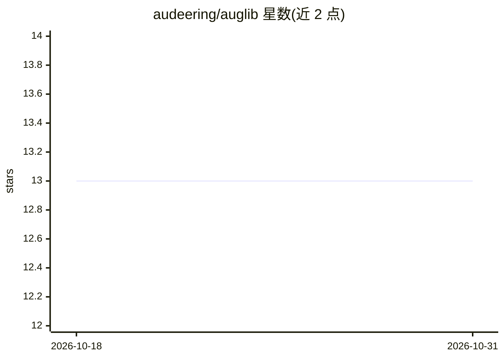

# audeering/auglib

⭐ 13 · Python · NOASSERTION · 推送 2026-10-10 · [GitHub](https://github.com/audeering/auglib) · [官网](https://audeering.github.io/auglib/) · 组织维护

**音频数据增强库：提供变换修改音频信号与文件**

audeering 维护的 Python 音频增强库，提供 transforms 对音频信号和文件做修改（如 PinkNoise 噪声变换），支持对整个数据集进行增强并缓存结果，可通过外部或用户自定义方式扩展增强函数。以 import 后几行代码即可对 signal 施加变换的形式使用，安装说明与示例在项目文档站给出。MIT 许可，多 Python 版本支持。

## 筛选速览

| 维度 | 判定 | 备注 |
|---|---|---|
| AI 角色 | `ai-ecosystem` | LLM/agent 周边工具 |
| 许可风险 | `permissive` | NOASSERTION |
| 部署形态 | `library` | 以包/库形式分发 |
| 模型依赖 | — | README 未给出锁定关系 |
| 硬件要求 | — | 无带数字的原话,不猜 |
| 安装摩擦 | `low` | 无编译、无系统依赖或容器化 |
| 成熟度 | — | 结构信号不足 |

## 能力要点

- 提供 transforms 变换集修改音频信号与文件
- 支持对整个数据集增强并缓存结果
- 可扩展外部或用户自定义增强
- 以 Python 库形式提供，几行代码完成增强

## 适用场景

- 为机器学习训练准备增强后的音频数据集
- 对音频信号或文件批量施加噪声等变换
- 自定义音频增强函数并复用

## 场景标签

 · 领域:音频/机器学习数据准备

## 证据(README 行号)

> L5: **auglib** is an augmentation library,
> L17: **auglib** can further augment whole datasets_

## 星数曲线

2026-10-18 13 → 2026-10-31 13（+0）

---
*卡片 v1 · prompt 1.4 · 生成 2026-10-31 · 置信度 mid · 依据 README sha `c84daf60b159` · [字段定义](../../DATASET.md)*
