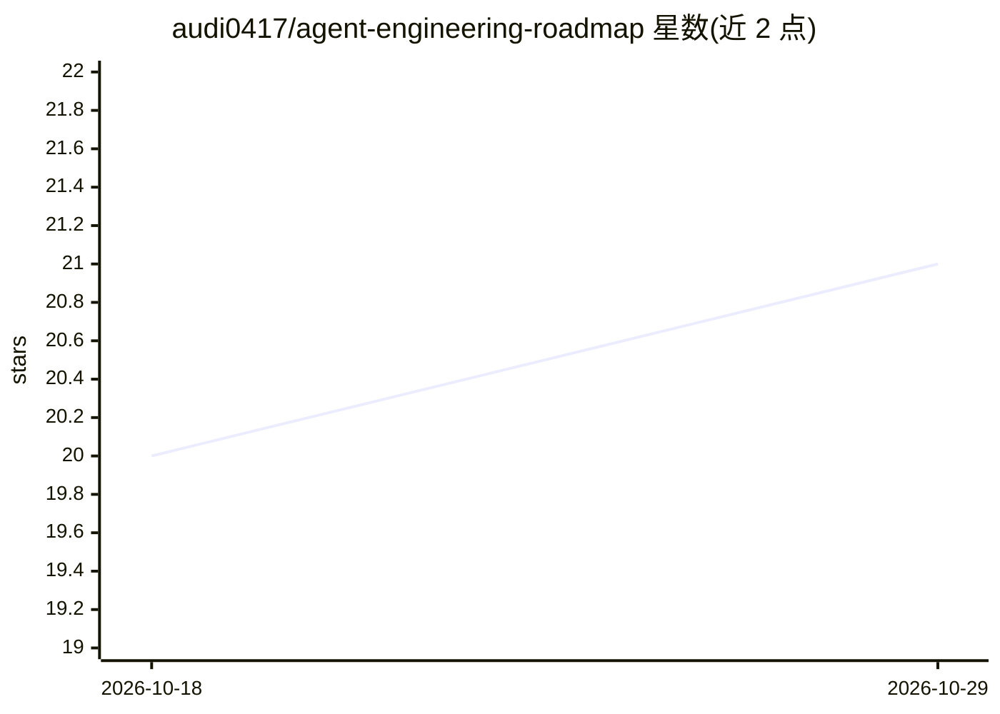

# audi0417/agent-engineering-roadmap

⭐ 21 · Python · MIT · 推送 2026-08-13 · [GitHub](https://github.com/audi0417/agent-engineering-roadmap) · [官网](https://audi0417.github.io/agent-engineering-roadmap/) · 个人维护 · 中文 README

**面向 AI 工程师的双语 Agent 工程实践课程路线图**

从 AI/LLM 基础到生产级多 Agent 系统的分阶段学习路径，覆盖工具调用、MCP、记忆系统、工作流、Agent Colony 与安全评估共 9 个层级（0-8）。提供 18 个无 API key 即可运行的 Python 示例、基准脚本、医疗/金融/企业领域的 showcase 与案例研究，以及教案、实验、测验和毕设模板。配套 MCP 服务器模板、评估与安全模板等课程材料，双语（英文/繁体中文）维护。

## 筛选速览

| 维度 | 判定 | 备注 |
|---|---|---|
| AI 角色 | `ai-knowledge` | 知识聚合/清单类 |
| 许可风险 | `permissive` | MIT |
| 部署形态 | `None` |  |
| 模型依赖 | — | README 未给出锁定关系 |
| 硬件要求 | — | 无带数字的原话,不猜 |
| 安装摩擦 | `low` | 无编译、无系统依赖或容器化 |
| 成熟度 | — | 结构信号不足 |

## 能力要点

- 0-8 级课程路径，覆盖单 Agent 到 Agent Colony 与生产安全
- 18 个无 API key 的可运行 Python 示例与基准脚本
- 医疗、金融、企业三个领域赛道与案例研究
- 教案、实验、测验、毕设与学习小组套件等教学材料

## 适用场景

- 系统学习从 chatbot demo 到生产级 Agent 的工程方法
- 直接运行示例验证工具调用、记忆、RAG 与评估机制
- 教学者按教案与学习小组套件组织 Agent 工程课程

## 场景标签

`教程课程` · 领域:学习与行业

## 证据(README 行号)

> L20:  A hands-on roadmap for building production-ready AI Agents, MCP Servers, Memory Systems, Multi-Agent Workflows, an
> L84: |Level|Topic|Outcome|
> L96: ## Course materials

## 星数曲线

2026-10-18 20 → 2026-10-29 21（+1）

---
*卡片 v1 · prompt 1.4 · 生成 2026-10-28 · 置信度 high · 依据 README sha `adefdb92dc2a` · [字段定义](../../DATASET.md)*
