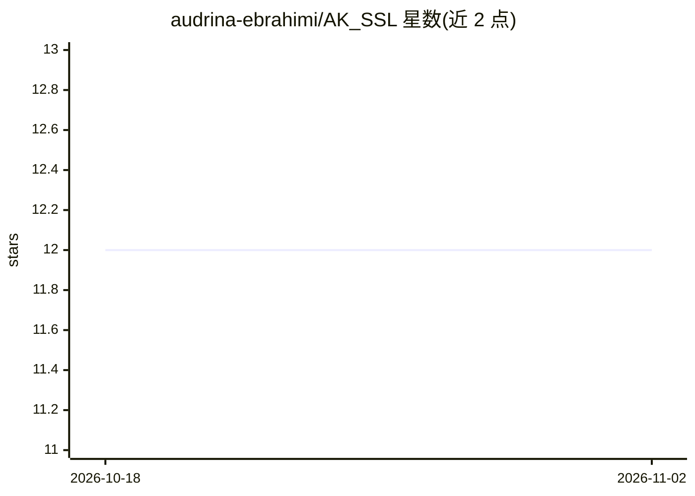

# audrina-ebrahimi/AK_SSL

⭐ 12 · Python · MIT · 推送 2025-11-17 · [GitHub](https://github.com/audrina-ebrahimi/AK_SSL) · 组织维护

**自监督学习方法的 PyTorch 实现：供研究者实验预训练技术**

Python 自监督学习库，为研究人员和实践者提供多种自监督方法的实现：Barlow Twins、BYOL、DINO、MoCo v2/v3、SimCLR、SimSiam、SwAV、CLIP、ALBEF、SLIP 等。每个方法以损失函数、数据增强、投影头/预测头的组合方式组织，并附论文与原始代码链接；利用无标注数据预训练模型后可在小规模标注数据上微调。项目源于伊朗伊斯法罕大学 ILS 实验室的暑期学徒与毕业项目，以 PyPI 包发布，代码风格 black。

## 筛选速览

| 维度 | 判定 | 备注 |
|---|---|---|
| AI 角色 | `ai-native` | 本体是模型或模型工具 |
| 许可风险 | `permissive` | MIT |
| 部署形态 | `library` | 以包/库形式分发 |
| 模型依赖 | — | README 未给出锁定关系 |
| 硬件要求 | — | 无带数字的原话,不猜 |
| 安装摩擦 | `low` | 无编译、无系统依赖或容器化 |
| 成熟度 | — | 结构信号不足 |

## 能力要点

- 覆盖 10 余种自监督方法（BYOL/DINO/MoCo/SimCLR/CLIP/ALBEF 等）
- 每种方法给出损失、增强与投影/预测头的组合结构及论文链接
- 基于 PyTorch，通过 PyPI 发布

## 适用场景

- 在无标注图像数据上预训练表征模型再微调
- 对比不同自监督方法的实现细节
- 学习各方法的损失与结构组合方式

## 场景标签

`模型训练` · 领域:训练与推理

## 证据(README 行号)

> L11: Welcome to the Self-Supervised Learning Library! This repository hosts a collection of tools and implementations fo
> L18: ## 🔎 Supported Methods

## 星数曲线

2026-10-18 12 → 2026-11-02 12（+0）

---
*卡片 v1 · prompt 1.4 · 生成 2026-11-01 · 置信度 high · 依据 README sha `99624eee18bd` · [字段定义](../../DATASET.md)*
