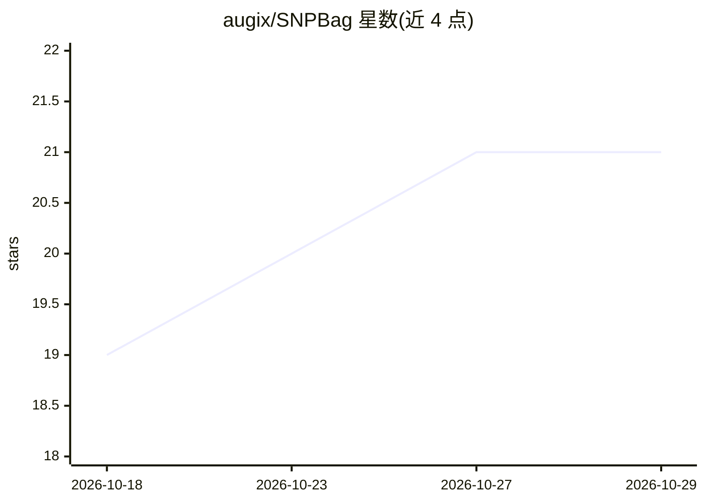

# augix/SNPBag

⭐ 21 · Jupyter Notebook · 推送 2025-12-17 · [GitHub](https://github.com/augix/SNPBag) · [官网](https://www.biorxiv.org/content/10.1101/2025.01.29.635579v3) · 组织维护

**基因组变异基础模型：SNP 预训练，支持插补/分期等 5 项任务**

SNPBag 是基于 100 万合成个体全基因组 SNP 数据预训练的语言模型，面向生物样本库规模的人类基因组变异分析。当前微调支持 5 项任务：基因型插补、单倍型分期、基因组嵌入、祖源推断和亲缘推断。提供在线推理服务（部署于 A800 与 RTX3090 服务器），仓库目录包含复现论文图表的代码。尚在 bioRxiv 预印本阶段，README 未给出安装与本地运行命令。

## 筛选速览

| 维度 | 判定 | 备注 |
|---|---|---|
| AI 角色 | `ai-native` | 本体是模型或模型工具 |
| 许可风险 | `none` | — |
| 部署形态 | `None` |  |
| 模型依赖 | — | README 未给出锁定关系 |
| 硬件要求 | — | 无带数字的原话,不猜 |
| 安装摩擦 | `low` | 无编译、无系统依赖或容器化 |
| 成熟度 | — | 结构信号不足 |

## 能力要点

- 100 万合成个体全基因组 SNP 数据预训练
- 微调覆盖插补/分期/嵌入/祖源/亲缘 5 项任务
- 提供 4 项任务的在线推理服务（Demo）
- 仓库含论文图表复现代码

## 适用场景

- 对 SNP 芯片数据做基因型插补
- 生成个体基因组嵌入用于下游分析
- 推断个体祖源或亲缘关系

## 场景标签

 · 领域:基因组学/生物信息

## 证据(README 行号)

> L2: Towards a universal foundation model for biobank-scale human genome variation.
> L6: SNPBag is a large language model pre-trained with whole-genome SNP data from 1 million synthetic individuals. It is 

## 星数曲线

2026-10-18 19 → 2026-10-29 21（+2）

---
*卡片 v1 · prompt 1.4 · 生成 2026-10-28 · 置信度 high · 依据 README sha `f04f14050164` · [字段定义](../../DATASET.md)*
