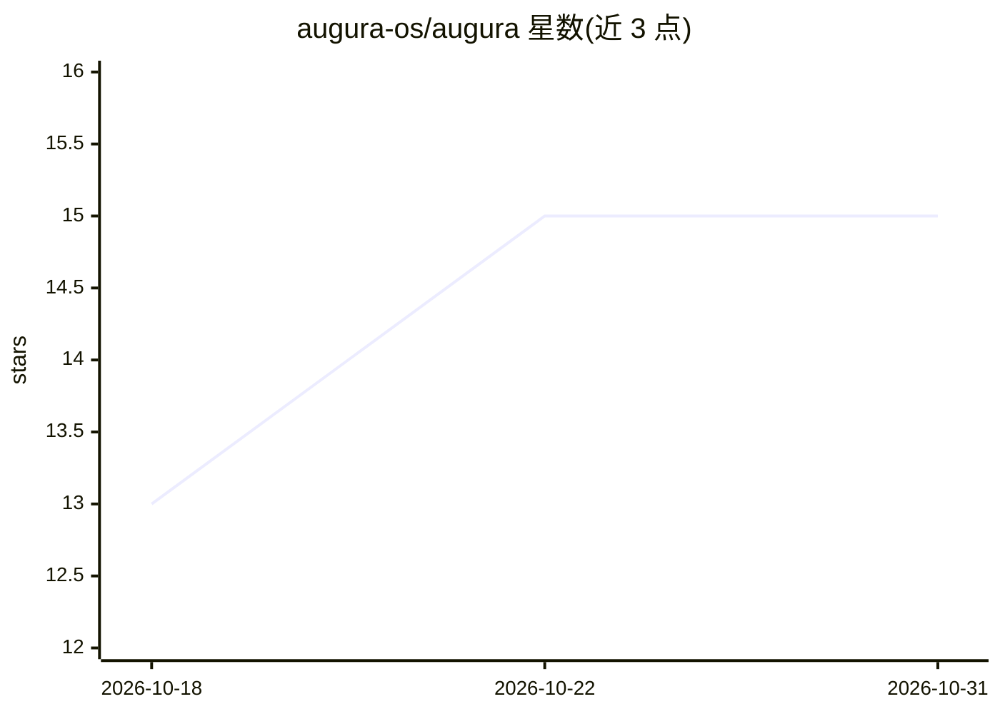

# augura-os/augura

⭐ 15 · Python · NOASSERTION · 推送 2026-10-29 · [GitHub](https://github.com/augura-os/augura) · 组织维护 · 中文 README

**面向手游 UA 团队的本地优先创意知识图谱系统**

面向手游买量团队的创意情报系统：上传广告素材后由视觉模型抽帧分析为结构化 JSON（钩子/冲突/玩法/奖励），并以 Neo4j 构建五层知识图谱（DNA→Creative→Variant→Asset→Tag）。人工裁决（合并/拆分/迭代判定）被持久记录，后续由 LLM 自一致性投票给出建议、人工一键确认；Daily Brief 由 18 条命名规则产出 KEEP/ITERATE/PAUSE/ARCHIVE 建议。数据默认留在本机，需自配 OpenAI 兼容 API key。单用户本地工具，多项目需多实例运行。

## 筛选速览

| 维度 | 判定 | 备注 |
|---|---|---|
| AI 角色 | `ai-native` | 本体是模型或模型工具 |
| 许可风险 | `none` | NOASSERTION |
| 部署形态 | `self-host` | docker 或自建部署 |
| 模型依赖 | local-ok | 支持本地模型 |
| 硬件要求 | — | 无带数字的原话,不猜 |
| 安装摩擦 | `low` | 无编译、无系统依赖或容器化 |
| 成熟度 | — | 结构信号不足 |

## 能力要点

- 视觉模型抽帧将素材分解为 hook/conflict/gameplay/reward 结构化 JSON，低置信结果转人工审核
- 五层 Neo4j 知识图谱（DNA→Creative→Variant→Asset→Tag）可视化创意世界
- 人工裁决持久化：merge guard 记住曾判'非同一素材'的配对，重复判断仅做一次
- Daily Brief 基于 18 条命名规则（rules-v3）输出可追溯 reason_code 的 KEEP/ITERATE/PAUSE/ARCHIVE 建议

## 适用场景

- 手游 UA 团队沉淀创意策划的判断经验，人员离职不丢失
- 把素材库、投放数据与人工裁决关联成图谱，追踪迭代效果
- 上传 Facebook 投放报表，自动匹配 ROAS 并给出放大/迭代/停止建议

## 场景标签

`知识图谱` · 领域:知识与检索

## 证据(README 行号)

> L18: Augura systematizes this. Upload a creative and AI decomposes it into hook, conflict, gameplay and reward. Decompos
> L28: - **AI creative analysis** — videos are frame-sampled and read by a vision model into structured JSON (hook / confl
> L131: |AI|Any OpenAI-compatible endpoint (OpenAI / Kimi…), vision-model analysis + self-consistency judging|

## 星数曲线

2026-10-18 13 → 2026-10-31 15（+2）

---
*卡片 v1 · prompt 1.4 · 生成 2026-10-30 · 置信度 mid · 依据 README sha `40abd5e9e4b4` · [字段定义](../../DATASET.md)*
