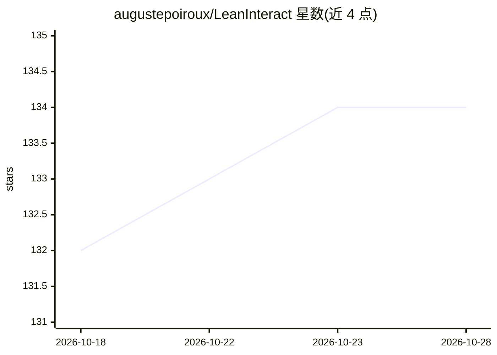

# augustepoiroux/LeanInteract

⭐ 135 · Python · MIT · 推送 2026-10-18 · [GitHub](https://github.com/augustepoiroux/LeanInteract) · [官网](https://augustepoiroux.github.io/LeanInteract/) · 组织维护

**通过 Lean REPL 从 Python 交互执行 Lean 4 的接口库**

LeanInteract 是一个 Python 包，封装 Lean REPL，支持从 Python 执行 Lean 代码与文件、按 tactic 步进证明、创建带依赖（如 Mathlib）的临时 Lean 项目、提取声明与 info tree、保存/恢复环境与证明状态，并提供增量与并行 elaboration。兼容 Lean v4.8.0-rc1 至 v4.36.0-rc1。主要面向定理证明与 autoformalization 研究者：示例脚本演示在 MiniF2F、ProofNet# 基准上运行 DeepSeek-Prover-V1.5 等模型并计算 BEq+ 指标。首次运行需下载并构建 Lean REPL。

## 筛选速览

| 维度 | 判定 | 备注 |
|---|---|---|
| AI 角色 | `ai-ecosystem` | LLM/agent 周边工具 |
| 许可风险 | `permissive` | MIT |
| 部署形态 | `library` | 以包/库形式分发 |
| 模型依赖 | — | README 未给出锁定关系 |
| 硬件要求 | — | 无带数字的原话,不猜 |
| 安装摩擦 | `low` | 无编译、无系统依赖或容器化 |
| 成熟度 | `idea` | |

## 能力要点

- 执行 Lean 代码/文件与 tactic 步进证明（ProofStep）
- 临时 Lean 项目与 Mathlib 依赖快捷配置
- 声明与 info tree 数据提取（v0.9.0）
- 增量+并行 elaboration 及环境/证明状态 pickling
- AutoLeanServer 崩溃恢复与内存监控

## 适用场景

- 在 MiniF2F/ProofNet# 基准上运行证明生成模型并评测
- 从 Lean 项目提取声明构建数据集
- 批量并行运行 Lean 类型检查与证明搜索

## 场景标签

`科研工具` `模型评测` · 领域:评测与运维

## 证据(README 行号)

> L9: **LeanInteract** is a Python package designed to seamlessly interact with Lean 4 through the Lean REPL.
> L47: - `proof_generation_and_autoformalization.py`: use DeepSeek-Prover-V1.5, Goedel-Prover, and other models on MiniF2F
> L395:   author = {Poiroux, Auguste and Kuncak, Viktor and Bosselut, Antoine},

## 星数曲线

2026-10-18 132 → 2026-10-28 134（+2）

---
*卡片 v1 · prompt 1.4 · 生成 2026-10-22 · 置信度 high · 依据 README sha `8d992b5a8aff` · [字段定义](../../DATASET.md)*
