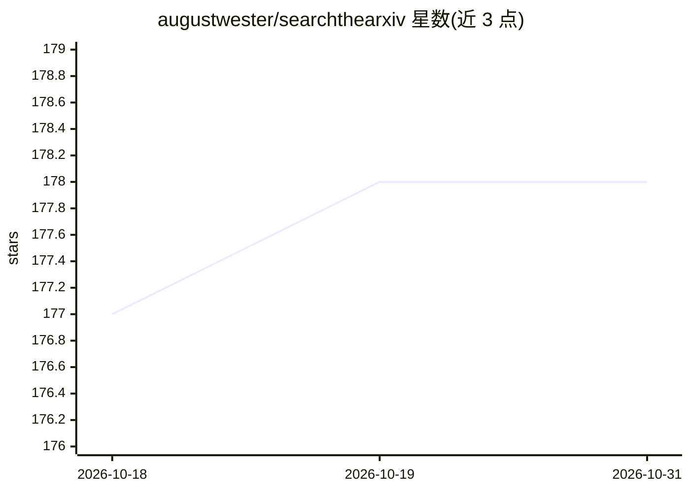

# augustwester/searchthearxiv

⭐ 178 · Python · GPL-3.0 · 推送 2026-05-17 · [GitHub](https://github.com/augustwester/searchthearxiv) · [官网](https://searchthearxiv.com) · 个人维护

**面向 arXiv 逾 50 万篇 ML 论文的语义搜索引擎源码**

searchthearxiv.com 网站的实现代码，对 arXiv 上超过 50 万篇机器学习论文做语义搜索。代码分 `app`（Web 前后端）与 `data`（定期更新数据库）两部分，后者用 OpenAI text-embedding-ada-002 生成嵌入、存入 Pinecone 向量索引，元数据经 Kaggle API 获取 Cornell 维护的 arXIV 元数据集。两部分均含 Dockerfile。作者不预期他人自部署克隆，定位为类似语义搜索引擎的参考实现；嵌入全量数据集约 15GB，完整嵌入前脚本会用 tiktoken 估算费用并要求确认。

## 筛选速览

| 维度 | 判定 | 备注 |
|---|---|---|
| AI 角色 | `ai-native` | 本体是模型或模型工具 |
| 许可风险 | `viral` | GPL-3.0 |
| 部署形态 | `self-host` | docker 或自建部署 |
| 模型依赖 | — | README 未给出锁定关系 |
| 硬件要求 | — | 无带数字的原话,不猜 |
| 安装摩擦 | `low` | 无编译、无系统依赖或容器化 |
| 成熟度 | — | 结构信号不足 |

## 能力要点

- 覆盖 50 万+ arXiv ML 论文的语义搜索
- OpenAI embedding + Pinecone 向量索引的 data 管道
- app 与 data 各含 Dockerfile，支持云端部署
- 完整嵌入数据集已发布在 Kaggle（约 15GB，每周增长）

## 适用场景

- 查找与查询语义相关的机器学习论文
- 参考其结构搭建自己的语义搜索引擎
- 直接获取 Kaggle 上的论文嵌入数据集用于其他项目

## 场景标签

`语义搜索` · 领域:知识与检索

## 证据(README 行号)

> L3: This repo contains the implementation of searchthearxiv.com, a simple semantic search engine for more than 500,000 M
> L15: The Kaggle username and API key are required to fetch the arXiv metadataset, maintained (and updated weekly) by Cor

## 星数曲线

2026-10-18 177 → 2026-10-31 178（+1）

---
*卡片 v1 · prompt 1.4 · 生成 2026-10-22 · 置信度 mid · 依据 README sha `62ef9d2fc1a8` · [字段定义](../../DATASET.md)*
