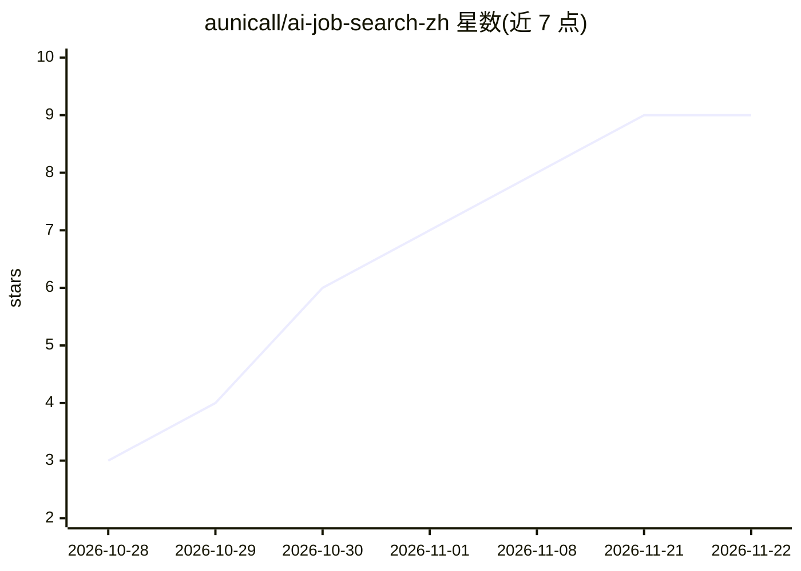

# aunicall/ai-job-search-zh

⭐ 9 · TypeScript · Apache-2.0 · 推送 2026-10-27 · [GitHub](https://github.com/aunicall/ai-job-search-zh) · 个人维护 · 中文 README

**本地求职者的全流程 AI 求职助手：职位、简历、投递、面试**

基于 Next.js 的本地 AI 求职应用，覆盖职位发现、简历定制、投递管理与面试练习：聚合猎聘、BOSS直聘、智联招聘、前程无忧等来源并计算匹配度，生成岗位专属简历（六种模板，导出 Word/PDF/Markdown），跟踪投递进度，生成面试准备包与文字/语音模拟面试。AI 能力通过 Codex、CodeBuddy 或 Claude Code CLI 接入，本地部署，单机监听 127.0.0.1，不支持静态部署，需桌面浏览器环境读取招聘平台。

## 筛选速览

| 维度 | 判定 | 备注 |
|---|---|---|
| AI 角色 | `ai-native` | 本体是模型或模型工具 |
| 许可风险 | `permissive` | Apache-2.0 |
| 部署形态 | `None` |  |
| 模型依赖 | — | README 未给出锁定关系 |
| 硬件要求 | — | 无带数字的原话,不猜 |
| 安装摩擦 | `low` | 无编译、无系统依赖或容器化 |
| 成熟度 | — | 结构信号不足 |

## 能力要点

- 聚合多个招聘来源并按个人档案分析职位匹配度
- 简历定制支持六种模板与 Word/PDF/Markdown 导出
- 文字与语音模拟面试、3D 面试官与逐题反馈
- 身份信息留在本地，发送 AI 前脱敏处理

## 适用场景

- 想在本地管理从找职位到面试复盘的完整求职流程
- 针对具体岗位生成定制简历和沟通话术
- 求职前用模拟面试练习并获得逐题反馈

## 场景标签

`AI 助手` `AI 写作` · 领域:对话与助手

## 证据(README 行号)

> L7: **Offer来敲门**是一款覆盖求职全流程的开源 AI 助手，帮助您发现合适的机会、呈现真实的职业优势，并为每一次面试做好准备。从职位筛选、简历定制到投递跟进与面试复盘，让每一步求职都有据可依。
> L24: - 至少一个已安装、登录且有可用额度的 **Codex、CodeBuddy 或 Claude Code CLI**，参见引擎配置。
> L86: - **AI 处理求职内容**：发送前脱敏已知身份信息，将经历、技能、职位描述、相关笔记、面试题与作答等任务上下文交给所选 CLI。Codex、CodeBuddy、Claude Code 分别通过其配置的 OpenAI、腾讯或 A

## 星数曲线

2026-10-28 3 → 2026-11-22 9（+6）

---
*卡片 v1 · prompt 1.4 · 生成 2026-11-20 · 置信度 high · 依据 README sha `2e4f026f3ab4` · [字段定义](../../DATASET.md)*
