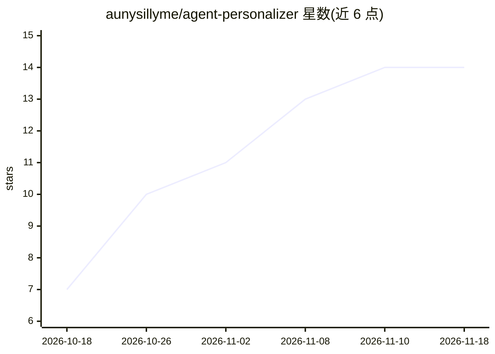

# aunysillyme/agent-personalizer

⭐ 14 · JavaScript · MIT · 推送 2026-11-14 · [GitHub](https://github.com/aunysillyme/agent-personalizer) · [官网](https://agent-personalizer.aunysillyme.dev) · 个人维护

**从单一源为多个 AI 客户端生成并同步自定义指令**

以 npm 包形式提供的 CLI 工具：将一份用户画像（USER.md）与规则源渲染为各 AI 客户端读取的指令文件（CLAUDE.md、AGENTS.md、GEMINI.md、ChatGPT 粘贴文件等），并用漂移检查保持生成副本与源一致。通过经确认的学习条目（LEARNED.md）与可选的本地会话摘要积累偏好；提供三级安装深度、全局安装、渲染器、禁用字符串门与隐私控制。运行于 Node.js，本地执行、无遥测。

## 筛选速览

| 维度 | 判定 | 备注 |
|---|---|---|
| AI 角色 | `ai-ecosystem` | LLM/agent 周边工具 |
| 许可风险 | `permissive` | MIT |
| 部署形态 | `library` | 以包/库形式分发 |
| 模型依赖 | — | README 未给出锁定关系 |
| 硬件要求 | — | 无带数字的原话,不猜 |
| 安装摩擦 | `low` | 无编译、无系统依赖或容器化 |
| 成熟度 | — | 结构信号不足 |

## 能力要点

- 单一画像与规则源渲染为 Claude Code/Codex/Cursor/Gemini CLI/ChatGPT 等各客户端指令文件
- 漂移检查：生成文件与源不一致时退出非零
- 经确认/拒绝的学习条目（LEARNED.md）跨所选 AI 目标共享，重跑不覆盖
- 本地运行，安装器与渲染器无网络调用、无遥测，提供禁用字符串检查与卸载

## 适用场景

- 在多个 AI 编程客户端间保持一致的个人偏好与规则
- 让 AI 助手通过问答学习我的习惯并固化为规则
- 分享指令前检查文件中是否含私有字符串

## 场景标签

`提示工程` `Agent 记忆` · 领域:Agent 开发

## 证据(README 行号)

> L5: **Every AI you use gets the same profile and the rules it can carry:** Claude Code, Codex, Cursor, Gemini CLI, Herme
> L9: **What you get:** One profile and one rule source, rendered into the exact file each AI reads, with a check that fai

## 星数曲线

2026-10-18 7 → 2026-11-18 14（+7）

---
*卡片 v1 · prompt 1.4 · 生成 2026-11-18 · 置信度 high · 依据 README sha `ad27497f02e7` · [字段定义](../../DATASET.md)*
