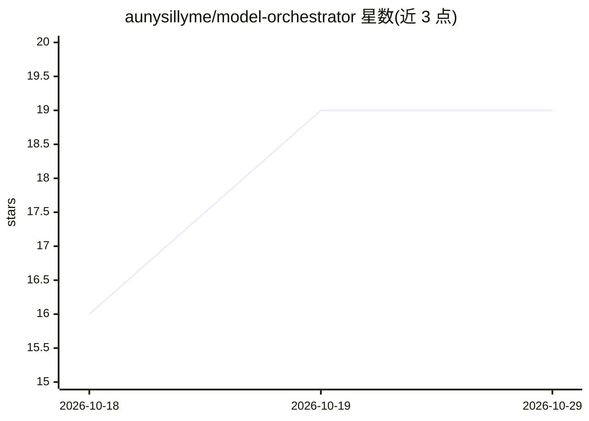

# aunysillyme/model-orchestrator

⭐ 19 · JavaScript · MIT · 推送 2026-10-28 · [GitHub](https://github.com/aunysillyme/model-orchestrator) · [官网](https://model-orchestrator.aunysillyme.dev) · 个人维护

**AI 编码代理的模型路由器：按规则把日常任务分给廉价模型**

面向 AI 编码代理的工具：通过可编辑的路由规则、8 个子代理、hooks 与 CLI lane runner，把批量工作、阅读类任务分配给廉价模型，把规划与困难决策留给更强模型。安装器检测已装 AI CLI（Claude Code、Codex、Grok、Ollama 等）生成任务委派方案与验收检查；`aunx route` 基于关键词分类给出确定性路由建议，`aunx cli-run` 以退出码与检查命令验证委派结果并支持配额后切换 lane。它位于请求层之上，可与 LiteLLM/OpenRouter 等代理组合。以 npm 包分发，另提供 Claude Code 插件与 Agensi 技能包。

## 筛选速览

| 维度 | 判定 | 备注 |
|---|---|---|
| AI 角色 | `ai-ecosystem` | LLM/agent 周边工具 |
| 许可风险 | `permissive` | MIT |
| 部署形态 | `desktop` | 安装包/桌面程序 |
| 模型依赖 | local-ok | 支持本地模型 |
| 硬件要求 | — | 无带数字的原话,不猜 |
| 安装摩擦 | `low` | 无编译、无系统依赖或容器化 |
| 成熟度 | — | 结构信号不足 |

## 能力要点

- 路由规则决策树区分规划/批量/阅读/审查等任务类型
- lane runner 记录每次运行的模型与 effort，验收检查失败以 exit 24 退出
- 配额耗尽后按 fallbacks.json 切换到另一计费池的 lane
- 本地路由指标记录与汇总（aunx route-metrics）

## 适用场景

- 让 AI 编码代理把例行工作交给廉价模型以控制成本
- 多个 AI CLI 之间做任务委派与角色分配
- 给委派任务附带验收检查并自动验证结果

## 场景标签

`模型网关` · 领域:Agent 开发

## 证据(README 行号)

> L5: **Model router for AI coding agents: routes routine work to cheaper models with routing rules, 8 subagents, hooks an
> L68: An HTTP proxy or gateway such as LiteLLM, Portkey, OpenRouter or claude-code-router swaps the model per request und
> L71: - **Pick model-orchestrator** for task delegation across your agents, model tiers and CLIs.

## 星数曲线

2026-10-18 16 → 2026-10-29 19（+3）

---
*卡片 v1 · prompt 1.4 · 生成 2026-10-28 · 置信度 high · 依据 README sha `8fefb2964334` · [字段定义](../../DATASET.md)*
