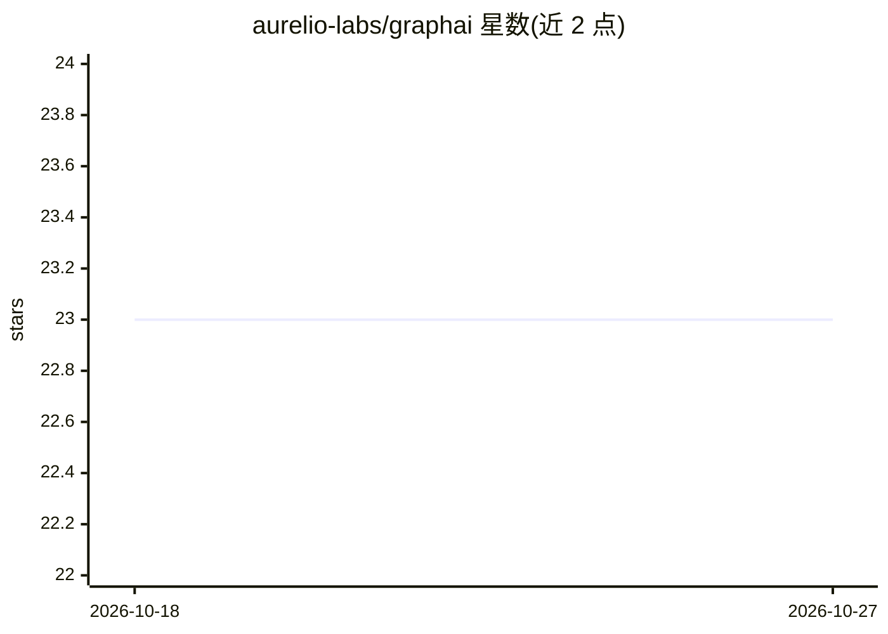

# aurelio-labs/graphai

⭐ 23 · Python · 推送 2026-09-11 · [GitHub](https://github.com/aurelio-labs/graphai) · [官网](https://pypi.org/project/graphai-lib/) · 组织维护

**面向 AI 工程师的极简异步图式 Agent 框架**

由 aurelio-labs 维护的 Python agent 框架，设计原则为异步优先、最小化抽象、一件事只有一种做法、基于图的 AI 结构。README 仅含哲学与安装说明，通过 pip 安装 graphai-lib 包使用。文档未展示具体模块、API 或示例，处于早期公开阶段的库，面向构建 agent 的开发者。

## 筛选速览

| 维度 | 判定 | 备注 |
|---|---|---|
| AI 角色 | `ai-ecosystem` | LLM/agent 周边工具 |
| 许可风险 | `none` | — |
| 部署形态 | `library` | 以包/库形式分发 |
| 模型依赖 | — | README 未给出锁定关系 |
| 硬件要求 | — | 无带数字的原话,不猜 |
| 安装摩擦 | `low` | 无编译、无系统依赖或容器化 |
| 成熟度 | — | 结构信号不足 |

## 能力要点

- 异步优先、最小化抽象的设计原则
- 图结构的 agent 组织方式
- 以 pip 包 graphai-lib 形式提供

## 适用场景

- 开发者用图结构组织异步 agent 流程
- 偏好少抽象层的轻量 agent 开发

## 场景标签

`Agent 框架` · 领域:Agent 开发

## 证据(README 行号)

> L3: 1. Async-first
> L6: 4. Graph-based AI

## 星数曲线

2026-10-18 23 → 2026-10-27 23（+0）

---
*卡片 v1 · prompt 1.4 · 生成 2026-10-27 · 置信度 mid · 依据 README sha `13be01de9484` · [字段定义](../../DATASET.md)*
