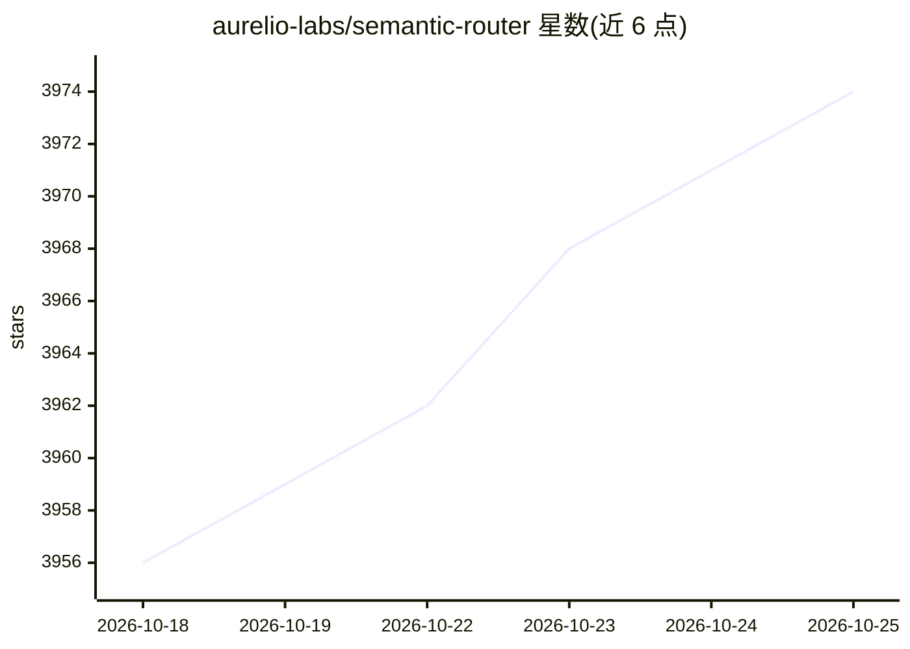

# aurelio-labs/semantic-router

⭐ 3,974 · Python · MIT · 推送 2026-10-22 · [GitHub](https://github.com/aurelio-labs/semantic-router) · [官网](https://www.aurelio.ai/semantic-router) · 组织维护

**面向 LLM 与 Agent 的毫秒级语义路由决策层**

Python 库，为 LLM 应用和 Agent 提供快速决策：将请求的语义与预定义 Route 在向量空间比对，或调用小型决策模型，毫秒级输出路由结果并附可校准的置信度；支持校准为概率并设阈值以返回‘无匹配’。编码器支持本地 FastEmbed 及 OpenAI、Cohere、Hugging Face 等；路由索引可存于 Pinecone、Qdrant 或 Postgres，支持多模态（图像/文本）路由与混合检索。有 1.x 与 0.x 两条发布线，0.x 仅收 bug 修复。

## 筛选速览

| 维度 | 判定 | 备注 |
|---|---|---|
| AI 角色 | `ai-ecosystem` | LLM/agent 周边工具 |
| 许可风险 | `permissive` | MIT |
| 部署形态 | `library` | 以包/库形式分发 |
| 模型依赖 | — | README 未给出锁定关系 |
| 硬件要求 | — | 无带数字的原话,不猜 |
| 安装摩擦 | `low` | 无编译、无系统依赖或容器化 |
| 成熟度 | — | 结构信号不足 |

## 能力要点

- 向量空间语义比对或小型决策模型，毫秒级路由决策
- 置信度可经 fit() 校准为概率并设阈值
- 编码器支持本地 FastEmbed（无需 API key）及 OpenAI/Cohere/HF 等
- 生产索引支持 Pinecone/Qdrant/Postgres，支持多模态与混合检索

## 适用场景

- 为聊天机器人快速决定话题走向（如回避政治话题）
- Agent 工具调用前的低延迟路由分流
- 完全本地化、无 API key 的语义路由部署

## 场景标签

 · 领域:LLM 基础设施

## 证据(README 行号)

> L11: Semantic Router is a superfast decision-making layer for your LLMs and agents. Rather than waiting for slow LLM gen
> L96: - **`DecisionRouter`** asks a decision model (TypeSafe's Jev, Laya or Von) which route applies, and can answer seve

## 星数曲线

2026-10-18 3,956 → 2026-10-25 3,974（+18）

---
*卡片 v1 · prompt 1.4 · 生成 2026-10-20 · 置信度 high · 依据 README sha `c476ea665a29` · [字段定义](../../DATASET.md)*
