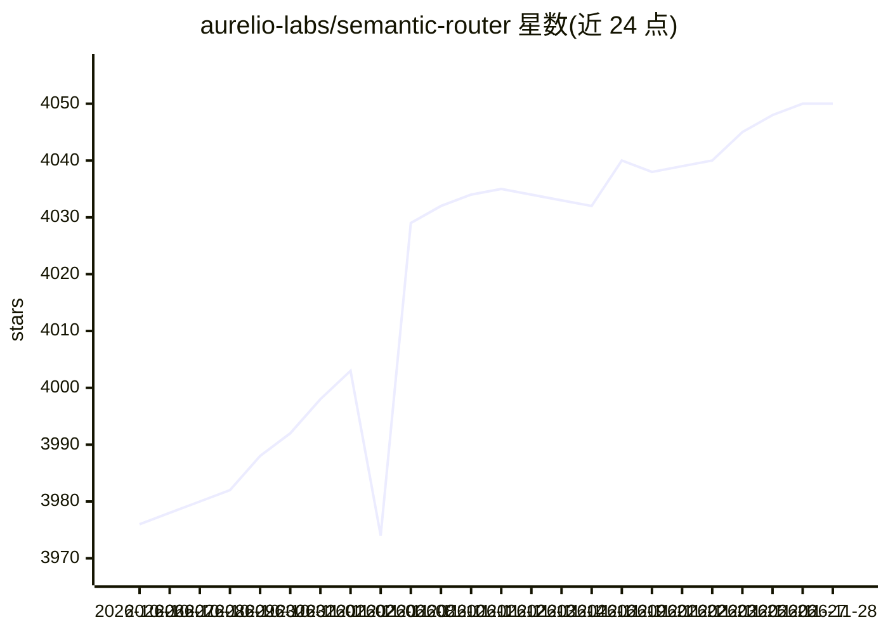

# aurelio-labs/semantic-router

⭐ 4,050 · Python · MIT · 推送 2026-11-27 · [GitHub](https://github.com/aurelio-labs/semantic-router) · [官网](https://www.aurelio.ai/semantic-router) · 组织维护

**为 LLM/agent 提供毫秒级语义路由决策的库**

Python 库，在 LLM 与 agent 之前增加一层语义决策：将请求的语义向量与预定义 Route（utterance 集合）比对，或调用小型决策模型单次完成判定，输出带可校准置信度的路由结果。默认可用本地 FastEmbed 嵌入模型、无需 API key 完整运行；encoder 支持 OpenAI、Cohere、Hugging Face 等；路由索引可存于 Pinecone、Qdrant 或 Postgres，支持稀疏混合检索与图文多模态路由。两条发布线：1.x 重建版与仅维护修复的 0.x（止于 0.3.0）。

## 筛选速览

| 维度 | 判定 | 备注 |
|---|---|---|
| AI 角色 | `ai-ecosystem` | LLM/agent 周边工具 |
| 许可风险 | `permissive` | MIT |
| 部署形态 | `library` | 以包/库形式分发 |
| 模型依赖 | — | README 未给出锁定关系 |
| 硬件要求 | — | 无带数字的原话,不猜 |
| 安装摩擦 | `low` | 无编译、无系统依赖或容器化 |
| 成熟度 | — | 结构信号不足 |

## 能力要点

- 毫秒级语义路由决策，每条判定带可校准置信度
- 默认本地 FastEmbed 嵌入，全程无 API key 运行
- DecisionRouter 用决策模型在单次调用回答多个问题
- 支持 Pinecone/Qdrant/Postgres 生产索引与图像多模态路由

## 适用场景

- 让 chatbot 按语义分流话题（如规避政治话题）
- 在 agent 中快速决定是否调用某工具
- 简单查询由快速路由处理，不确定时回退到慢速 LLM

## 场景标签

`语义搜索` · 领域:知识与检索

## 证据(README 行号)

> L11: Semantic Router is a superfast decision-making layer for your LLMs and agents. Rather than waiting for slow LLM gen
> L20: pip install -qU "semantic-router>=1,<2"   # 1.x
> L96: - **`DecisionRouter`** asks a decision model (TypeSafe's Jev, nace.ai's Drex, Laya or Von) which route applies, and

## 星数曲线

2026-10-26 3,976 → 2026-11-28 4,050（+74）

---
*卡片 v1 · prompt 1.4 · 生成 2026-11-26 · 置信度 high · 依据 README sha `e699e5cbf886` · [字段定义](../../DATASET.md)*
