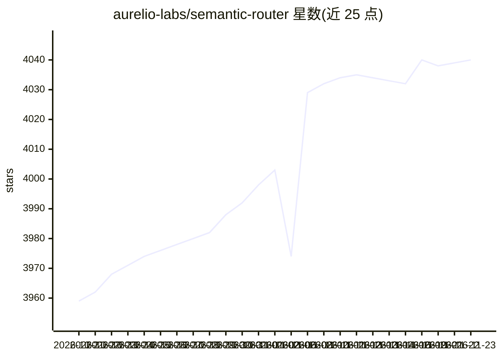

# aurelio-labs/semantic-router

⭐ 4,040 · Python · MIT · 推送 2026-11-22 · [GitHub](https://github.com/aurelio-labs/semantic-router) · [官网](https://www.aurelio.ai/semantic-router) · 组织维护

**为 LLM 与 agent 提供毫秒级语义路由决策的 Python 库**

Semantic Router 在 LLM 生成之前充当决策层：将请求的语义与预定义 Route 在向量空间中比对，或在单次快速调用中询问小决策模型，毫秒级输出工具使用等决策，并给出可校准为真实概率的置信度。提供 IndexedRouter（嵌入+匹配）、DecisionRouter（决策模型）、Chain/Merge 组合路由、稀疏混合检索、Pinecone/Qdrant/Postgres 生产索引与图像多模态路由。Quickstart 可用本地 FastEmbed 模型完全离线运行，无需 API key。通过 PyPI 提供两条发布线（1.x 主线与 0.x 仅修复线）。

## 筛选速览

| 维度 | 判定 | 备注 |
|---|---|---|
| AI 角色 | `ai-ecosystem` | LLM/agent 周边工具 |
| 许可风险 | `permissive` | MIT |
| 部署形态 | `library` | 以包/库形式分发 |
| 模型依赖 | — | README 未给出锁定关系 |
| 硬件要求 | — | 无带数字的原话,不猜 |
| 安装摩擦 | `low` | 无编译、无系统依赖或容器化 |
| 成熟度 | — | 结构信号不足 |

## 能力要点

- 毫秒级语义比对决策，带可校准置信度（fit() + 阈值）
- 本地 FastEmbed 路径无 API key、完全离线运行
- DecisionRouter 单次调用回答多个 yes/no/选择/评分问题
- 支持 Pinecone/Qdrant/Postgres 索引与图像多模态路由

## 适用场景

- 让 chatbot 对话题分类并避开政治类对话
- 在 agent 中快速决定调用哪个工具而无需等 LLM 生成
- 用 Chain 让快路由先回答，不确定时再落到慢路由
- 医疗行政流程等场景按语义分流请求

## 场景标签

`聊天机器人` `多模态` `语义搜索` · 领域:对话与助手

## 证据(README 行号)

> L11: Semantic Router is a superfast decision-making layer for your LLMs and agents. Rather than waiting for slow LLM gen
> L97: - **`Chain`** answers easy queries from a fast router and falls through to a slower one only when it isn't sure. **

## 星数曲线

2026-10-21 3,959 → 2026-11-23 4,040（+81）

---
*卡片 v1 · prompt 1.4 · 生成 2026-11-23 · 置信度 high · 依据 README sha `362f8a8e8ab1` · [字段定义](../../DATASET.md)*
