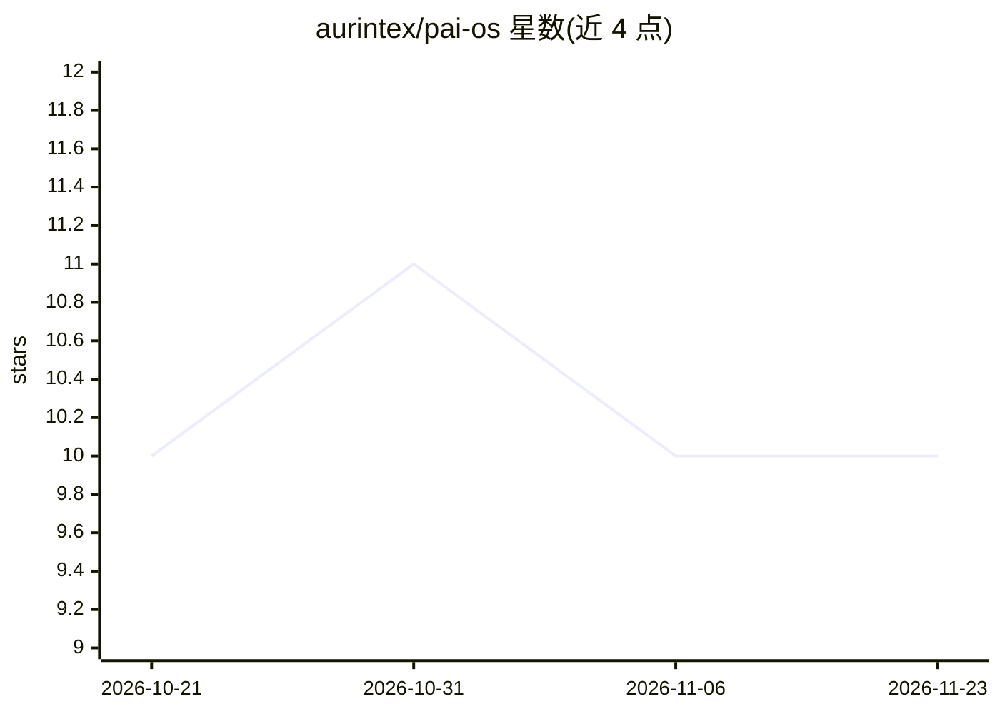

# aurintex/pai-os

⭐ 10 · Rust · AGPL-3.0 · 推送 2026-10-22 · [GitHub](https://github.com/aurintex/pai-os) · [官网](https://docs.aurintex.com/) · 组织维护

**为个人 AI 硬件（服务器/可穿戴）提供的开源操作系统**

面向个人 AI 硬件的模块化操作系统，规划两种形态：paiLink 便携 AI 服务器（基于 Radxa Rock 5C）与 paiGo 独立 AI 可穿戴设备。核心 paiEngine 以 Rust 编写，通过六边形架构与硬件解耦，提供 Ollama 兼容端点供 VS Code、Obsidian、Open WebUI 等应用接入本地推理；paiGo 增加摄像头与麦克风实现多模态感知与情境记忆。使用 Debos 构建基于 Debian 的不可变 OS 镜像，当前处于 Phase 0 基础建设阶段。

## 筛选速览

| 维度 | 判定 | 备注 |
|---|---|---|
| AI 角色 | `ai-ecosystem` | LLM/agent 周边工具 |
| 许可风险 | `viral` | AGPL-3.0 |
| 部署形态 | `None` |  |
| 模型依赖 | local-ok | 支持本地模型 |
| 硬件要求 | — | 无带数字的原话,不猜 |
| 安装摩擦 | `medium` | 含编译或系统依赖之一 |
| 成熟度 | `idea` | |

## 能力要点

- 提供 Ollama 兼容端点，支持 Ollama 的应用可直接接入本地推理
- 本地优先设计：推理在设备端完成，含可选云端回退
- Rust 实现的 paiEngine，通过 REST/gRPC/MCP 对外暴露接口
- 使用 Debos 构建可复现的 Debian 基础 OS 镜像

## 适用场景

- 为现有支持 Ollama 的开发/写作/聊天工具提供私有本地 AI 后端
- 在 Radxa Rock 5C 上构建脱网运行的推理设备
- 开发者在 paiEngine 之上基于 REST/gRPC/MCP 构建自定义界面

## 场景标签

`推理引擎` · 领域:训练与推理

## 证据(README 行号)

> L33: **The Idea:** Plug it in, and any app that supports Ollama (or a compatible API) can use paiOS for inference. Your 
> L93:     Engine["⚙️ paiEngine\n(Rust · Tokio)"] -- "REST / gRPC / MCP" --> Clients
> L101: * **Platform Flexibility:** `paiEngine` is a flexible API platform. For wearables (paiGo), the smartphone app (pai

## 星数曲线

2026-10-21 10 → 2026-11-23 10（+0）

---
*卡片 v1 · prompt 1.4 · 生成 2026-11-19 · 置信度 high · 依据 README sha `b5f734a0624c` · [字段定义](../../DATASET.md)*
