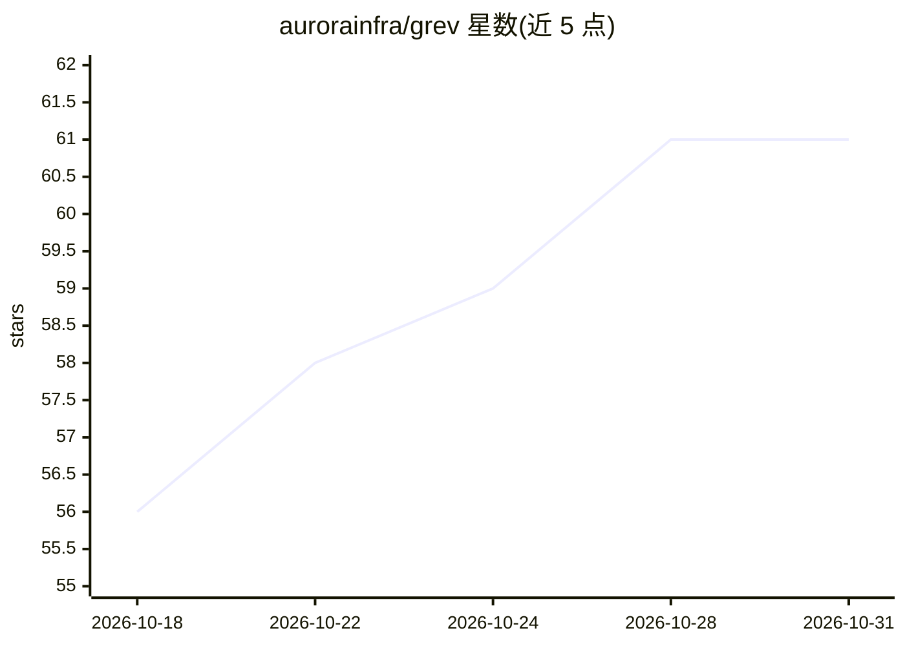

# aurorainfra/grev

⭐ 61 · Go · Apache-2.0 · 推送 2026-10-02 · [GitHub](https://github.com/aurorainfra/grev) · 组织维护

**基于类型化模型问答的 Unix 命令行过滤器工具集**

一套模仿 coreutils 用法的命令行工具（grev/isv/oneof/tagv/sortv 等约 17 个），运行于 TypeSafe 的 Jev 模型：以带校准概率的类型化问答代替文本生成，对每条记录判定/标注/排序，输出始终为输入本身，标签与分数仅作为显式列。支持按描述过滤日志、CSV 列选择、语义排序与分割流等。提供 OpenRouter（同一 Jev API）与 Fastino（GLiDE 模型）两种替换端点；内置报价确认、单次/每日/每月费用上限与配置管理。通过 deb/rpm/apk/Arch 包、Go install 或源码编译安装，并附带 Agent Skill 供编码代理调用。

## 筛选速览

| 维度 | 判定 | 备注 |
|---|---|---|
| AI 角色 | `ai-native` | 本体是模型或模型工具 |
| 许可风险 | `permissive` | Apache-2.0 |
| 部署形态 | `desktop` | 安装包/桌面程序 |
| 模型依赖 | — | README 未给出锁定关系 |
| 硬件要求 | — | 无带数字的原话,不猜 |
| 安装摩擦 | `medium` | 含编译或系统依赖之一 |
| 成熟度 | — | 结构信号不足 |

## 能力要点

- 约 17 个模仿 grep/sort/cut 等用法的类型化问答工具
- 输出始终是输入本身，标签与概率仅作显式列（如 -t 阈值、probev 概率列）
- 费用控制：报价确认（confirmAbove）、--max-cost、每日/月度上限、管道关闭即停止
- 可切换 OpenRouter（Jev API）或 Fastino（GLiDE）端点

## 适用场景

- 按语义而非正则过滤日志与文本流
- 在管道中对大量记录做批量标注、分类或语义排序
- 让编码代理通过 Agent Skill 在成本受控下使用这些工具

## 场景标签

`语义搜索` · 领域:知识与检索

## 证据(README 行号)

> L12: The tools run on TypeSafe's Jev models, which answer typed questions with
> L28: |`grev`|grep|print the records the model says yes to|

## 星数曲线

2026-10-18 56 → 2026-10-31 61（+5）

---
*卡片 v1 · prompt 1.4 · 生成 2026-10-24 · 置信度 mid · 依据 README sha `6f5a769b6c26` · [字段定义](../../DATASET.md)*
