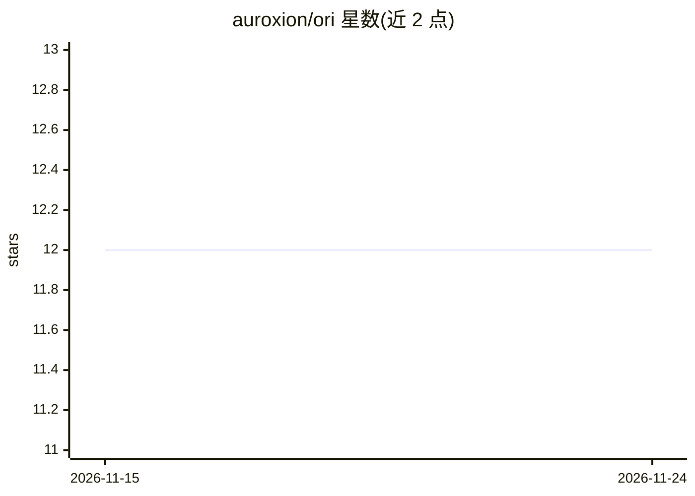

# auroxion/ori

⭐ 12 · C++ · GPL-3.0 · 推送 2026-11-21 · [GitHub](https://github.com/auroxion/ori) · 个人维护

**面向 Linux 终端用户的 AI 助手，TUI+Web 界面接入 OpenRouter**

基于 C++ 与 Textual 构建的终端优先 AI 助手，同时提供 TUI 与浏览器 GUI 双界面。通过 OpenRouter 接入多个 LLM（示例配置为 qwen3-coder:free），核心功能包括带确认机制的 agentic 命令执行、瞬时网络错误与限流的自动重试、插件系统与 Orpm 包管理。GUI 模式运行本地 Web 服务器（默认 8080 端口），提供聊天历史、模型选择器与代码画布。需自行编译（C++14 编译器、CMake、jsoncpp/libcurl），Arch 用户可经 AUR 安装。README 声明开发因维护者时间受限而放缓。

## 筛选速览

| 维度 | 判定 | 备注 |
|---|---|---|
| AI 角色 | `ai-native` | 本体是模型或模型工具 |
| 许可风险 | `viral` | GPL-3.0 |
| 部署形态 | `None` |  |
| 模型依赖 | locked-api |  |
| 硬件要求 | — | 无带数字的原话,不猜 |
| 安装摩擦 | `medium` | 含编译或系统依赖之一 |
| 成熟度 | — | 结构信号不足 |

## 能力要点

- TUI 与 Web GUI 双界面，GUI 默认运行于 localhost:8080
- 带确认机制的 agentic 命令执行与 /undo 回滚
- 自动重试瞬时网络错误与限流
- 插件系统与 Orpm 包管理，配置含 rag/skills 内存开关

## 适用场景

- 在终端中用自然语言执行 shell 任务（如查询内核版本）
- 通过浏览器 GUI 与多个 LLM 聊天并执行代码片段
- 为项目目录初始化并做 git 备份快照

## 场景标签

`AI 助手` · 领域:对话与助手

## 证据(README 行号)

> L7: > A terminal‑first AI assistant for Linux with both a Text User Interface (TUI) and a web-based Graphical User Inter
> L24: - Agentic command execution with confirmation.

## 星数曲线

2026-11-15 12 → 2026-11-24 12（+0）

---
*卡片 v1 · prompt 1.4 · 生成 2026-11-22 · 置信度 high · 依据 README sha `b3a9e0f310c9` · [字段定义](../../DATASET.md)*
