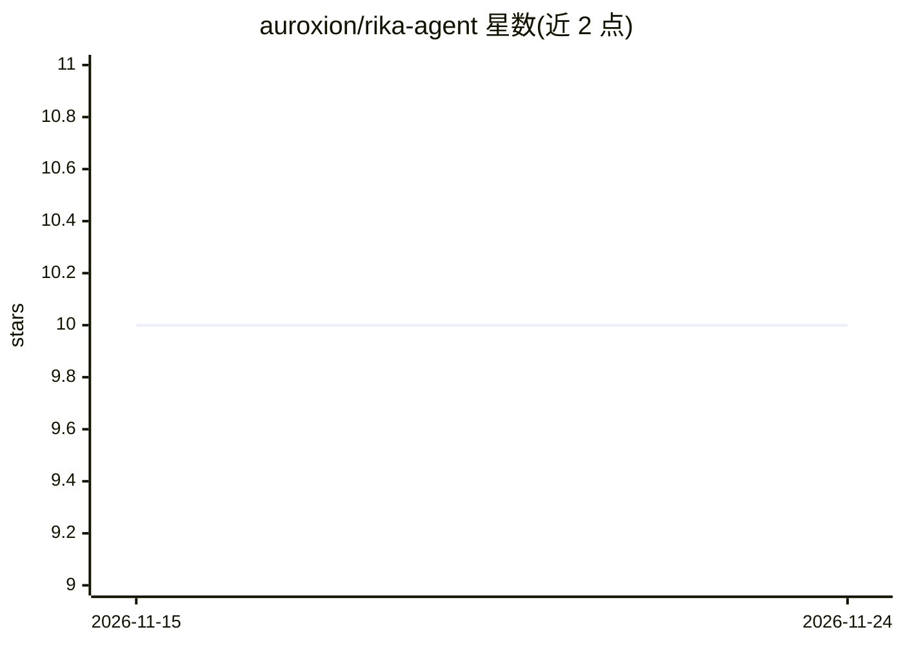

# auroxion/rika-agent

⭐ 10 · Python · Apache-2.0 · 推送 2026-07-06 · [GitHub](https://github.com/auroxion/rika-agent) · [官网](https://deepwiki.com/piratheon/rika-agent) · 个人维护

**自托管 Telegram 代理式 AI 机器人：在你自己的服务器上运行代理任务**

以 Telegram 为界面的自托管代理式 AI 系统：常驻用户服务器进程，直接访问 shell、文件系统与网络；提供最多 20 步工具调用的 ReAct 循环、7 类后台监视器、Qdrant 语义记忆、AES-256-GCM 加密密钥存储与 22 条 shell 命令防火墙。默认仅限 OWNER_USER_ID 一个 Telegram 用户使用。安装需 Python 3.12+ 与 Telegram bot token，支持脚本向导或 Docker 部署。

## 筛选速览

| 维度 | 判定 | 备注 |
|---|---|---|
| AI 角色 | `ai-native` | 本体是模型或模型工具 |
| 许可风险 | `permissive` | Apache-2.0 |
| 部署形态 | `self-host` | docker 或自建部署 |
| 模型依赖 | local-ok | 支持本地模型 |
| 硬件要求 | — | 无带数字的原话,不猜 |
| 安装摩擦 | `low` | 无编译、无系统依赖或容器化 |
| 成熟度 | — | 结构信号不足 |

## 能力要点

- 多轮 ReAct 代理循环（每次请求最多 20 个工具调用）
- 7 类后台监视器（CPU/进程/URL/端口/日志正则/cron/脚本）
- Qdrant 向量记忆与逐用户隔离的键值记忆
- 三级代码沙箱（RestrictedRestrictedPython / ulimit 进程 / Docker）

## 适用场景

- 在 Telegram 上让代理分析服务器日志并生成报告
- 对自己的服务器做异常监控并在 Telegram 收到告警
- 用本地 Ollama 模型零数据出站地运行个人代理

## 场景标签

`聊天机器人` · 领域:对话与助手

## 证据(README 行号)

> L27: > **rika-agent** is a privacy first open source agentic system that you can control via Telegram (using a bot) and 
> L33: Most "AI assistants" are wrappers that relay your messages to an API. rika-agent is different: it runs as a persist
> L29: >v2.1.9 ships JSON-native function calling, provider failover with live countdown UX, a three-level code sandbox, b

## 星数曲线

2026-11-15 10 → 2026-11-24 10（+0）

---
*卡片 v1 · prompt 1.4 · 生成 2026-11-19 · 置信度 mid · 依据 README sha `0cac25cf28fe` · [字段定义](../../DATASET.md)*
