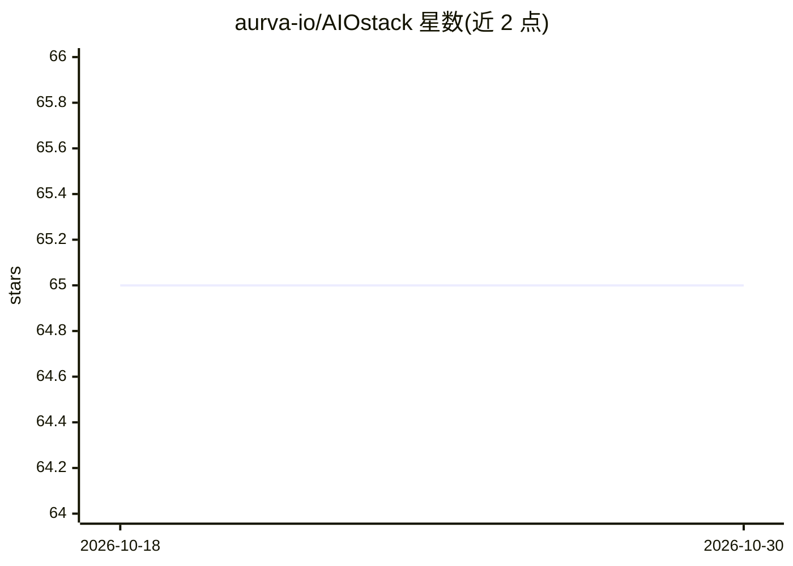

# aurva-io/AIOstack

⭐ 65 · Vue · Apache-2.0 · 推送 2026-09-03 · [GitHub](https://github.com/aurva-io/AIOstack) · [官网](https://aurva.ai) · 组织维护

**Kubernetes 上 AI 运行时可观测层：发现影子 AI 并追踪 LLM 调用**

Aurva 维护的社区版运行时可见性工具，面向安全与平台团队。基于 eBPF 在 Kubernetes 节点零侵入捕获 AI 流量元数据：自动发现影子 AI、LLM API 调用、向量数据库与 MCP 服务，生成 AIBOM 运行时清单；将 AI 流量关联到 Pod、service account 与团队身份，追踪跨服务调用链与 token 成本分摊，产出合规审计证据。不采集请求体。要求 Kubernetes 1.29+、Linux 内核 5.15+；企业版补充托管环境集成、告警与 SSO。

## 筛选速览

| 维度 | 判定 | 备注 |
|---|---|---|
| AI 角色 | `ai-ecosystem` | LLM/agent 周边工具 |
| 许可风险 | `permissive` | Apache-2.0 |
| 部署形态 | `library` | 以包/库形式分发 |
| 模型依赖 | — | README 未给出锁定关系 |
| 硬件要求 | — | 无带数字的原话,不猜 |
| 安装摩擦 | `low` | 无编译、无系统依赖或容器化 |
| 成熟度 | — | 结构信号不足 |

## 能力要点

- 零侵入 eBPF 检测：无 SDK、无 sidecar、不改应用代码
- 影子 AI 发现与 AIBOM 运行时清单
- AI 调用链跨服务追踪与 token/成本按团队归因
- 节点 CPU 开销 <2%，仅采集元数据不存请求体

## 适用场景

- 盘点集群里正在运行的 AI 服务与影子 AI
- 安全事件后将 AI 调用归因到具体 agent 与团队
- 为 GDPR/SOC2 审计生成带时间戳的 pod 级证据

## 场景标签

`LLM 可观测性` · 领域:评测与运维

## 证据(README 行号)

> L17: AIOStack is Aurva’s free community runtime visibility layer for AI workloads. It helps security and platform teams 
> L50: - **Zero-instrumentation discovery**: Automatically detect LLM API calls, model downloads, vector databases, MCP se

## 星数曲线

2026-10-18 65 → 2026-10-30 65（+0）

---
*卡片 v1 · prompt 1.4 · 生成 2026-10-24 · 置信度 high · 依据 README sha `884026fe8e6e` · [字段定义](../../DATASET.md)*
