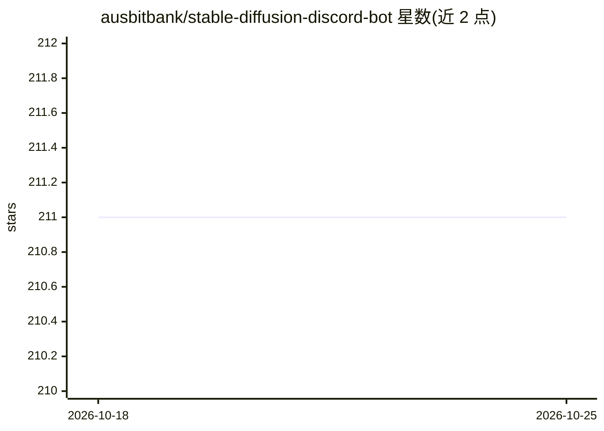

# ausbitbank/stable-diffusion-discord-bot

⭐ 211 · JavaScript · Unlicense · 推送 2026-03-27 · [GitHub](https://github.com/ausbitbank/stable-diffusion-discord-bot) · 个人维护

**调用 InvokeAI 生成 AI 图像并集成 LLM 聊天的 Discord 机器人**

面向 Discord 服务器的自托管机器人：通过 !dream 命令与参数调用 InvokeAI（兼容 5.4.3）生成图像，支持图生图、controlnet、ip_adapter、背景移除、节点图作业跟踪与 WebSocket 实时进度；另接入 LMStudio 提供 LLM 聊天、图像描述与提示词改进。安装方式为 git clone 源码后配置 config.json、安装自定义 InvokeAI 节点与 pip 依赖，再以 npm 或 docker-compose 启动。当前为 alpha 重写分支，自述尚未准备好公开使用。

## 筛选速览

| 维度 | 判定 | 备注 |
|---|---|---|
| AI 角色 | `ai-native` | 本体是模型或模型工具 |
| 许可风险 | `permissive` | Unlicense |
| 部署形态 | `self-host` | docker 或自建部署 |
| 模型依赖 | — | README 未给出锁定关系 |
| 硬件要求 | — | 无带数字的原话,不猜 |
| 安装摩擦 | `low` | 无编译、无系统依赖或容器化 |
| 成熟度 | `idea` | |

## 能力要点

- !dream 命令生成图像并支持 controlnet/ip_adapter 等输入图像处理
- 多后端 Invoke 集群支持与 WebSocket 实时作业进度跟踪
- LLM 集成：聊天、图像描述与提示词改进
- 利用 PNG 元数据实现刷新功能

## 适用场景

- 在自己的 Discord 服务器里用命令生成 AI 图像
- 多人共享 InvokeAI 集群排队生成图像并查看进度
- 借助 LLM 改进提示词或描述图片

## 场景标签

`图像生成` `聊天机器人` · 领域:对话与助手

## 证据(README 行号)

> L5: A powerful Discord bot that interfaces with InvokeAI, and LMStudio bringing advanced AI image generation and chat ca
> L20: - Classic `!dream prompt` command with parameter support
> L29: - LLM integration for chat, image description, and prompt improvement

## 星数曲线

2026-10-18 211 → 2026-10-25 211（+0）

---
*卡片 v1 · prompt 1.4 · 生成 2026-10-22 · 置信度 mid · 依据 README sha `f431eb7f7639` · [字段定义](../../DATASET.md)*
