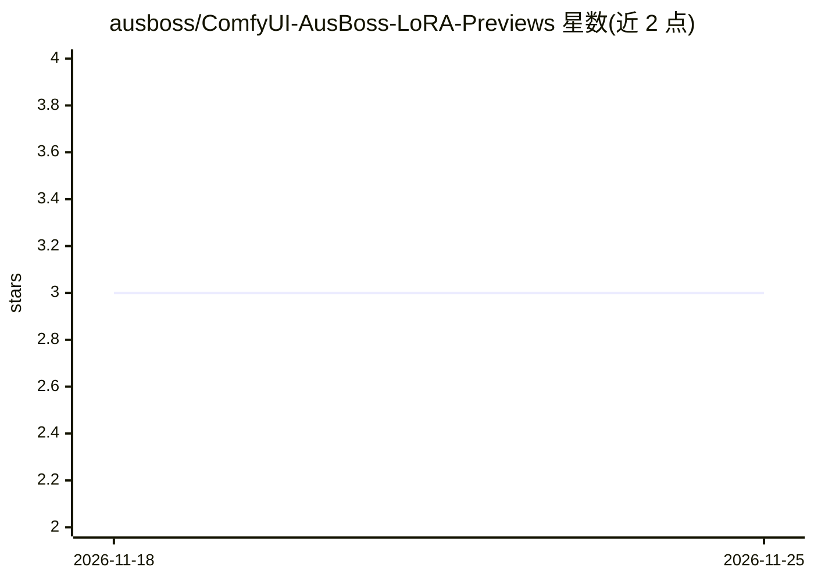

# ausboss/ComfyUI-AusBoss-LoRA-Previews

⭐ 3 · Python · MIT · 推送 2026-10-24 · [GitHub](https://github.com/ausboss/ComfyUI-AusBoss-LoRA-Previews) · [官网](https://github.com/ausboss/ComfyUI-AusBoss) · 个人维护

**给 ComfyUI LoRA 加载器显示 Civitai 预览图的插件**

ComfyUI-AusBoss LoRA 加载器的附加组件：点击 Fetch Civitai info 时，把该 LoRA 在 Civitai 页面的首张 PG/PG-13 静态图下载并保存为 <lora名>.preview.jpg，放在 LoRA 文件旁；此后悬停 LoRA 名称即可显示预览图，无需改动工作流或新增节点。仅依赖 ComfyUI 自带环境，需 ComfyUI-AusBoss 2.19.0+。仅识别 Civitai 已收录的 LoRA，自训练 LoRA 不获取图片。

## 筛选速览

| 维度 | 判定 | 备注 |
|---|---|---|
| AI 角色 | `ai-ecosystem` | LLM/agent 周边工具 |
| 许可风险 | `permissive` | MIT |
| 部署形态 | `None` |  |
| 模型依赖 | — | README 未给出锁定关系 |
| 硬件要求 | — | 无带数字的原话,不猜 |
| 安装摩擦 | `low` | 无编译、无系统依赖或容器化 |
| 成熟度 | — | 结构信号不足 |

## 能力要点

- 悬停 LoRA 名称即显示其 Civitai 预览图
- 图片保存为最大 768 像素、无元数据的 .preview.jpg，不覆盖已有预览
- 浏览器端下载并校验来源地址，服务器端仅写 LoRA 目录且不外联
- 提供成熟内容分级开关（Allow mature preview pictures）

## 适用场景

- 在 ComfyUI 中按预览图快速挑选已下载的 LoRA
- 为 LoRA 文件本地留存 Civitai 示例图
- 管理大量 LoRA 时避免逐个到 Civitai 查看效果

## 场景标签

`图像生成` · 领域:内容生成

## 证据(README 行号)

> L9: and in the **+ LoRA** list. It adds no nodes and nothing to your workflows.
> L11: You need ComfyUI-AusBoss 2.19.0
> L14: ## Install

## 星数曲线

2026-11-18 3 → 2026-11-25 3（+0）

---
*卡片 v1 · prompt 1.4 · 生成 2026-11-22 · 置信度 high · 依据 README sha `cb3de86b0b21` · [字段定义](../../DATASET.md)*
