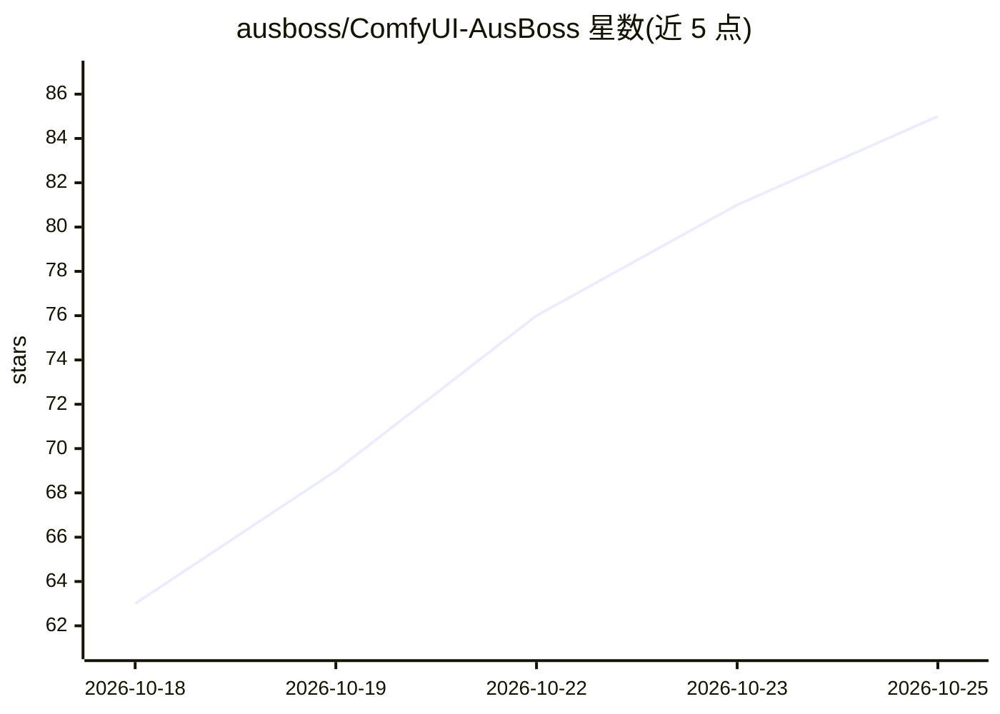

# ausboss/ComfyUI-AusBoss

⭐ 85 · JavaScript · MIT · 推送 2026-10-24 · [GitHub](https://github.com/ausboss/ComfyUI-AusBoss) · [官网](https://registry.comfy.org/nodes/ausboss-nodes) · 个人维护

**ComfyUI 图像/视频处理自定义节点包，含遮罩、裁剪、扩图、放大等**

作者为自身工作流编写的 ComfyUI 自定义节点集合，持续新增。节点覆盖：点击或输入名称生成物体遮罩（含发丝边缘细化）、拖拽手柄的裁剪/旋转/填充、保持原像素的 inpaint/outpaint 缝合、按兆像素分块放大、视频时间线裁剪、文件夹批处理、布局框、LoRA 堆栈与开关等。依赖 Pillow/NumPy/Torch/PyAV（随 ComfyUI 附带），LaMa inpaint 需自行放置 big-lama.pt 权重，包本身不下载权重。2.0 移除了 LM Studio Chat 等节点。通过 ComfyUI-Manager、comfy 命令行或 git clone 安装。

## 筛选速览

| 维度 | 判定 | 备注 |
|---|---|---|
| AI 角色 | `ai-ecosystem` | LLM/agent 周边工具 |
| 许可风险 | `permissive` | MIT |
| 部署形态 | `desktop` | 安装包/桌面程序 |
| 模型依赖 | — | README 未给出锁定关系 |
| 硬件要求 | — | 无带数字的原话,不猜 |
| 安装摩擦 | `medium` | 含编译或系统依赖之一 |
| 成熟度 | `idea` | |

## 能力要点

- Mask by Touch / Mask by Name：点击或输入名称生成遮罩与抠图，支持发丝边缘
- Stitch Inpaint 在 inpaint/outpaint 后将未编辑区域还原为原始像素
- 按兆像素设定目标的分块放大与拼接
- 单一节点内带独立开关与强度的 LoRA 堆栈

## 适用场景

- 在 ComfyUI 中为图像编辑工作流添加交互式遮罩与裁剪工具
- outpaint/inpaint 后保留原始像素细节
- 对文件夹内图片批量执行同一工作流

## 场景标签

`图像视频处理` `图像生成` · 领域:内容生成

## 证据(README 行号)

> L9: I made these nodes for my own ComfyUI workflows, mostly because I wanted features I couldn't find in other packs. I 
> L11: Most of them are for image and video work. ComfyUI's core nodes already cover the basics, like seeds, sizes and pro

## 星数曲线

2026-10-18 63 → 2026-10-25 85（+22）

---
*卡片 v1 · prompt 1.4 · 生成 2026-10-24 · 置信度 mid · 依据 README sha `3379d47df8d8` · [字段定义](../../DATASET.md)*
