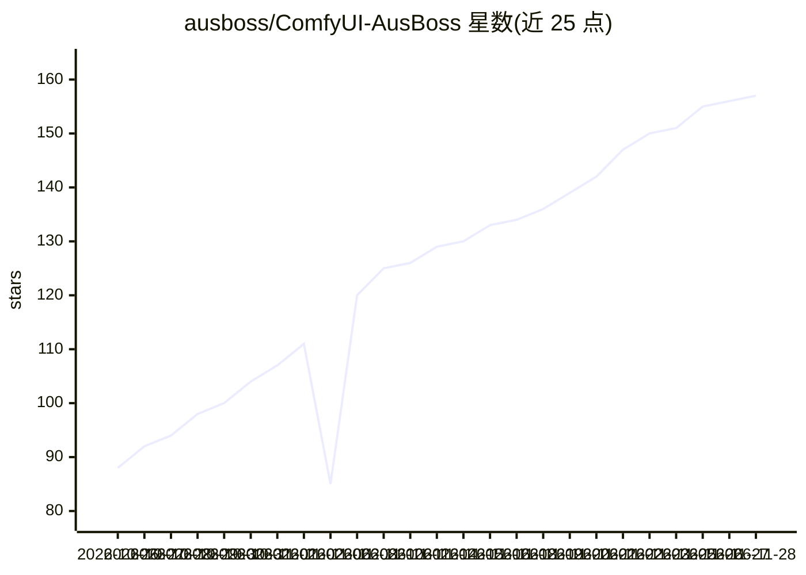

# ausboss/ComfyUI-AusBoss

⭐ 157 · JavaScript · MIT · 推送 2026-11-27 · [GitHub](https://github.com/ausboss/ComfyUI-AusBoss) · [官网](https://registry.comfy.org/nodes/ausboss-nodes) · 个人维护

**为 ComfyUI 工作流提供图像/视频遮罩、修补与裁剪节点包**

作者为自己 ComfyUI 工作流编写的自定义节点集合，覆盖按点击或文字描述生成遮罩、拖拽手柄裁剪/旋转/填充、保留原始像素的 inpaint/outpaint、分块放大、视频时间线裁剪、文件夹批量处理、LoRA 堆叠等。依赖 ComfyUI 自带的 Pillow/NumPy/Torch/PyAV，包本身不自动下载权重（LaMa Inpaint 需手动放置 big-lama.pt）。通过 ComfyUI-Manager 或 git clone 安装，提供 skills 安装方式供 AI agent 学习使用示例工作流。2.0 版移除了 LM Studio Chat 等节点。

## 筛选速览

| 维度 | 判定 | 备注 |
|---|---|---|
| AI 角色 | `ai-ecosystem` | LLM/agent 周边工具 |
| 许可风险 | `permissive` | MIT |
| 部署形态 | `desktop` | 安装包/桌面程序 |
| 模型依赖 | — | README 未给出锁定关系 |
| 硬件要求 | — | 无带数字的原话,不猜 |
| 安装摩擦 | `medium` | 含编译或系统依赖之一 |
| 成熟度 | — | 结构信号不足 |

## 能力要点

- 点击或输入名称生成目标遮罩，Fine edges 可贴合毛发边缘
- Stitch Inpaint 使未要求修改的区域保留原始像素
- 分块放大到指定百万像素，拼接并混色
- 支持 Claude Code/Codex/Cursor 等 agent 学习视频工作流用法

## 适用场景

- 图像 inpaint/outpaint 时只改动指定区域
- 批量对文件夹内图片运行工作流
- 视频按时间线裁剪并变换画幅
- 在 ComfyUI 中搭建分块放大流程

## 场景标签

`图像生成` · 领域:内容生成

## 证据(README 行号)

> L2:  ComfyUI nodes for image and video work.
> L12: I made these nodes for my own ComfyUI workflows, mostly because I wanted features I couldn't find in other packs. I
> L31: ## Install

## 星数曲线

2026-10-26 88 → 2026-11-28 157（+69）

---
*卡片 v1 · prompt 1.4 · 生成 2026-11-28 · 置信度 mid · 依据 README sha `c7e473a116d6` · [字段定义](../../DATASET.md)*
