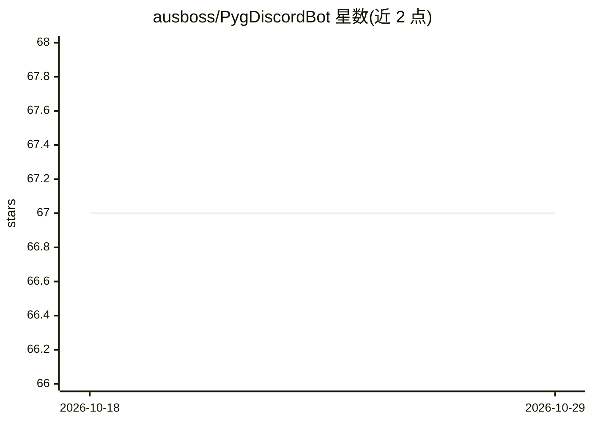

# ausboss/PygDiscordBot

⭐ 67 · Python · MIT · 推送 2026-05-05 · [GitHub](https://github.com/ausboss/PygDiscordBot) · 个人维护

**用本地 LLM 做角色扮演聊天的 Discord 机器人（2023 存档）**

Python 编写的 Discord 机器人，连接 KoboldAI 或 Oobabooga 的 text-generation-webui（--api）两种本地 LLM 后端，用 Pygmalion/TavernAI 风格的角色卡（PNG/JSON）进行角色扮演聊天。功能包括每频道滑动窗口记忆、BLIP 图片描述、可配置停止序列、listen-only 与 ping 模式、自动改头像与昵称匹配角色。项目 2023 年已归档不再维护，依赖版本固定于 2023 年中期的 LLM 工具生态（含 LangChain），README 声明仅作参考快照供 fork。安装通过 git clone 与 setup.bat/setup.sh 脚本创建虚拟环境。

## 筛选速览

| 维度 | 判定 | 备注 |
|---|---|---|
| AI 角色 | `ai-native` | 本体是模型或模型工具 |
| 许可风险 | `permissive` | MIT |
| 部署形态 | `None` |  |
| 模型依赖 | — | README 未给出锁定关系 |
| 硬件要求 | — | 无带数字的原话,不猜 |
| 安装摩擦 | `low` | 无编译、无系统依赖或容器化 |
| 成熟度 | — | 结构信号不足 |

## 能力要点

- 支持 KoboldAI 与 Oobabooga text-generation-webui 两种后端
- Tavern 风格角色卡（PNG/JSON）加载与启动时选择
- BLIP 图片描述后送入 LLM
- 每频道滑动窗口记忆与可配置停止序列

## 适用场景

- 在 Discord 频道里与本地 LLM 角色卡进行角色扮演聊天
- 让机器人自动将头像昵称切换为所选角色
- fork 该归档项目研究 2023 年 LLM 工具生态的接入方式

## 场景标签

`聊天机器人` · 领域:对话与助手

## 证据(README 行号)

> L5: A Discord bot that uses local LLMs and character cards (Pygmalion / TavernAI style) for casual roleplay chat. Suppor
> L12: - **Two LLM backends** — KoboldAI or Oobabooga (`text-generation-webui` with `--api`)
> L14: - **Image captions** — pasted images are run through BLIP and described back to the LLM

## 星数曲线

2026-10-18 67 → 2026-10-29 67（+0）

---
*卡片 v1 · prompt 1.4 · 生成 2026-10-24 · 置信度 high · 依据 README sha `946d2787e672` · [字段定义](../../DATASET.md)*
