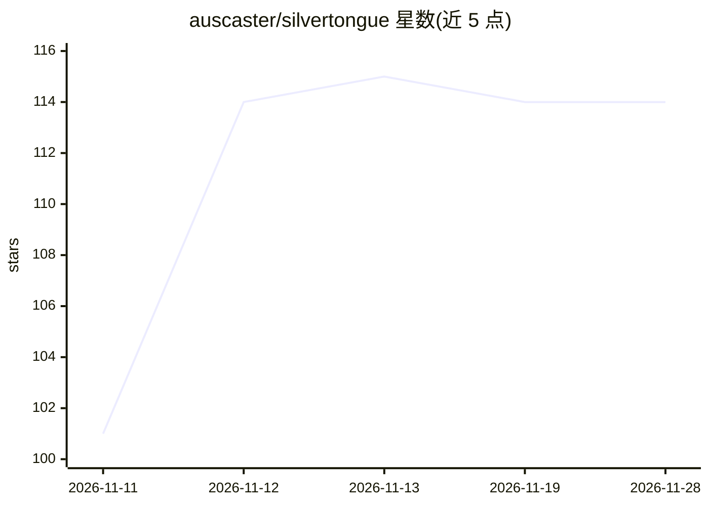

# auscaster/silvertongue

⭐ 114 · TypeScript · Apache-2.0 · 推送 2026-11-18 · [GitHub](https://github.com/auscaster/silvertongue) · [官网](https://silvertongue.dev) · 个人维护

**65+ 名人写作风格档案库，供 agent/MCP/PR 审查使用**

开源的名人写作声音目录：每个声音是一个 profiles/ 下的文件夹，含 VOICE.md（九部分结构化格式，覆盖镜头、招式、语感、禁忌、签名句等）与 profile.json（范围、来源、验证状态）。声音基于本人公开发表的言论研究而成，来源全部链接，盲测通过后才标记 verified。同一 VOICE.md 可通过任意 agent、Claude Code/Codex 插件、Gemini CLI 扩展、MCP 服务与浏览器扩展使用；另提供 GitHub Action，用指定声音（如 Gordon Ramsay）包装 AI 代码审查，原始发现保留在展示层之下。设声音移除申请通道与四条内容规则（只模仿风格不冒充身份等）。

## 筛选速览

| 维度 | 判定 | 备注 |
|---|---|---|
| AI 角色 | `ai-knowledge` | 知识聚合/清单类 |
| 许可风险 | `permissive` | Apache-2.0 |
| 部署形态 | `None` |  |
| 模型依赖 | locked-api |  |
| 硬件要求 | — | 无带数字的原话,不猜 |
| 安装摩擦 | `low` | 无编译、无系统依赖或容器化 |
| 成熟度 | `idea` | |

## 能力要点

- VOICE.md v0 九部分格式，每个声音附来源链接与验证状态
- GitHub Action：Claude 官方 code-review 工作流 + OpenAI Codex 审查，由名人声音风格呈现
- 同一档案可运行于任意 agent、MCP 客户端、Claude Code/Codex 插件与 Gemini CLI 扩展
- MCP 服务支持线程中途切换声音

## 适用场景

- 让我的 agent 用指定名人口吻改写草稿，保留原事实与数字
- 在 PR 审查中以名人声音获得 AI 代码审查反馈
- 通过盲测验证的声音研究方式了解某人写作风格的构成

## 场景标签

`代码审查` `提示工程` · 领域:Agent 开发

## 证据(README 行号)

> L5: An open catalogue of famous writing voices for your agent, your browser and your pull requests.
> L89: Founders and builders, creators, stars, comedians, famous characters, essayists, classic writers and politicians, a
> L131: |**Any MCP client**|`https://mcp.silvertongue.dev/mcp`, with voice switching mid-thread|Now|

## 星数曲线

2026-11-11 101 → 2026-11-28 114（+13）

---
*卡片 v1 · prompt 1.4 · 生成 2026-11-17 · 置信度 high · 依据 README sha `b618296d4f31` · [字段定义](../../DATASET.md)*
