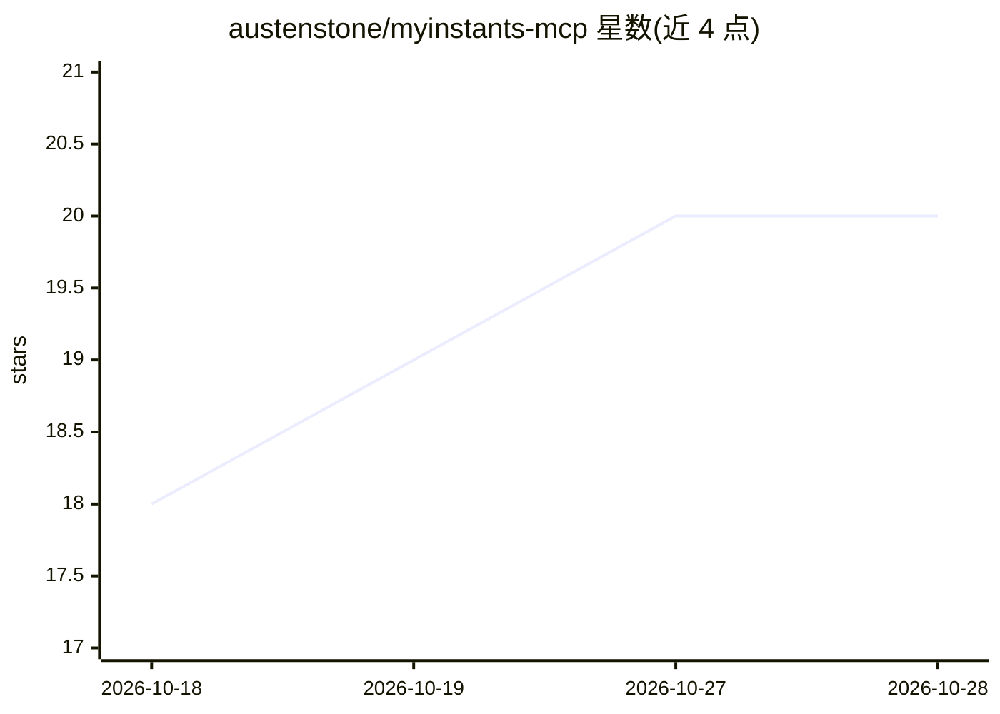

# austenstone/myinstants-mcp

⭐ 20 · JavaScript · 推送 2026-03-17 · [GitHub](https://github.com/austenstone/myinstants-mcp) · [官网](https://myinstants.com) · 个人维护

**让 AI agent 播放 myinstants.com 音效按钮的 MCP 服务器**

一个 MCP server，将 AI agent 接入 myinstants.com 音效网站：提供搜索音效、按 slug/URL 播放、浏览 14 个分类、查看热门与最佳榜单等工具，声音通过本机播放器（afplay/ffplay/mpv，自动检测回退链）从扬声器播出并自动排队不重叠。给出 VS Code、Claude Desktop、Cursor 的 MCP 配置示例，支持音量、阻塞等待、指定输出设备与播放器等环境变量。macOS 开箱即用（原生 afplay），Linux 需安装 ffmpeg；播放器（ffmpeg/mpv）为平台相关的系统依赖。

## 筛选速览

| 维度 | 判定 | 备注 |
|---|---|---|
| AI 角色 | `ai-ecosystem` | LLM/agent 周边工具 |
| 许可风险 | `none` | — |
| 部署形态 | `library` | 以包/库形式分发 |
| 模型依赖 | — | README 未给出锁定关系 |
| 硬件要求 | — | 无带数字的原话,不猜 |
| 安装摩擦 | `medium` | 含编译或系统依赖之一 |
| 成熟度 | — | 结构信号不足 |

## 能力要点

- 提供 search_sounds/play_sound/browse_category 等 MCP 工具与 trending/categories/best 资源
- 自动检测 afplay→ffplay→mpv 播放器回退链，声音自动排队不重叠
- npx myinstants-mcp 一条命令运行，无需额外配置
- 支持 MYINSTANTS_VOLUME/WAIT/DEVICE/PLAYER 等环境变量指定设备与播放器

## 适用场景

- 让编程 agent 在编译成功或测试失败时播放音效反馈
- 在 VS Code/Claude Desktop/Cursor 中为 AI 助手接入网络音效板
- 通过对话让 agent 搜索并即时播放 meme 音效

## 场景标签

 · 领域:开发者工具/娱乐

## 证据(README 行号)

> L28: an MCP server that connects AI agents to myinstants.com — the internet's largest soundboard. millions of meme sound
> L88: |Tool|What it does|It's giving|

## 星数曲线

2026-10-18 18 → 2026-10-28 20（+2）

---
*卡片 v1 · prompt 1.4 · 生成 2026-10-28 · 置信度 high · 依据 README sha `b2a43e526cc3` · [字段定义](../../DATASET.md)*
