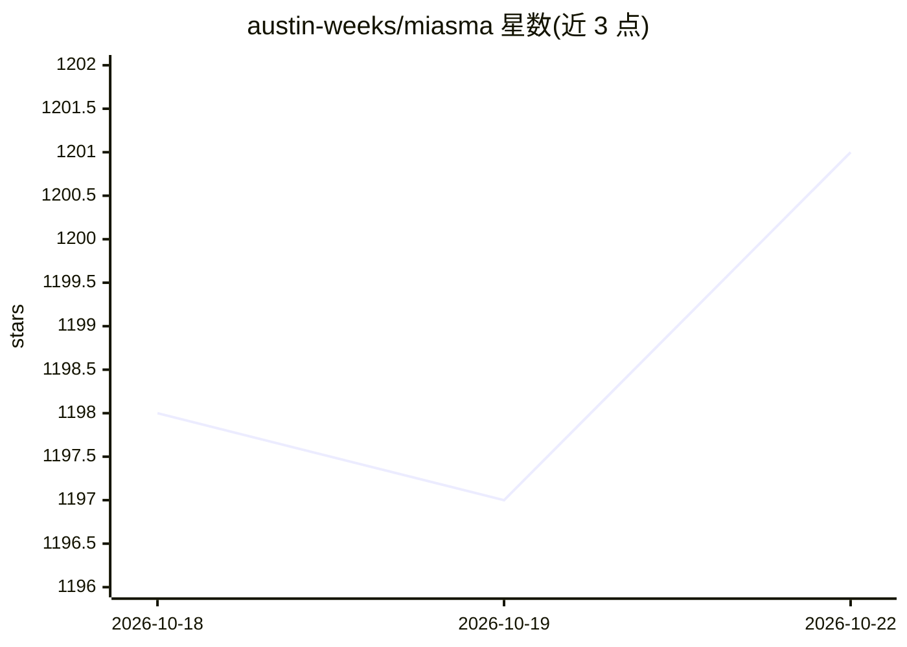

# austin-weeks/miasma

⭐ 1,203 · Rust · GPL-3.0 · 推送 2026-10-11 · [GitHub](https://github.com/austin-weeks/miasma) · [官网](https://austin-weeks.github.io/miasma/) · 组织维护

**向 AI 爬虫投喂毒化训练数据的网站反爬工具**

面向公开网站运营者的反爬虫服务：不直接拦截 AI 爬虫，而是返回掺入毒化训练数据的内容并附带自引用链接，使爬虫陷入循环，以此降低抓取数据对模型训练的价值。以 Rust 实现，宣称占用内存小、运行快。分发形式包括 Docker 镜像、Rust 库、预编译二进制及包管理器安装；README 附部署风险警告与免责声明提示。

## 筛选速览

| 维度 | 判定 | 备注 |
|---|---|---|
| AI 角色 | `ai-enhanced` | 去掉 AI 部分产品仍成立 |
| 许可风险 | `viral` | GPL-3.0 |
| 部署形态 | `self-host` | docker 或自建部署 |
| 模型依赖 | — | README 未给出锁定关系 |
| 硬件要求 | — | 无带数字的原话,不猜 |
| 安装摩擦 | `low` | 无编译、无系统依赖或容器化 |
| 成熟度 | — | 结构信号不足 |

## 能力要点

- 向爬虫返回毒化训练数据与自引用链接构成循环
- 提供 Docker 镜像、Rust 库、预编译二进制与包管理器安装
- README 明示部署存在风险并指向免责声明

## 适用场景

- 我有公开网站，想阻止 AI 公司把内容抓去训练模型
- 我不只想拦截爬虫，还想降低被抓取数据的价值
- 用 Docker 在自己服务器上部署防护层

## 场景标签

 · 领域:网络安全/反爬虫

## 证据(README 行号)

> L11: AI companies continually scrape the internet at an enormous scale, swallowing up all of its contents to use as trai
> L15: Miasma does just that! It sends poisoned training data to scrapers alongside self-referential links. Scrapers get c

## 星数曲线

2026-10-18 1,198 → 2026-10-22 1,201（+3）

---
*卡片 v1 · prompt 1.4 · 生成 2026-10-21 · 置信度 mid · 依据 README sha `36c38f5175d7` · [字段定义](../../DATASET.md)*
