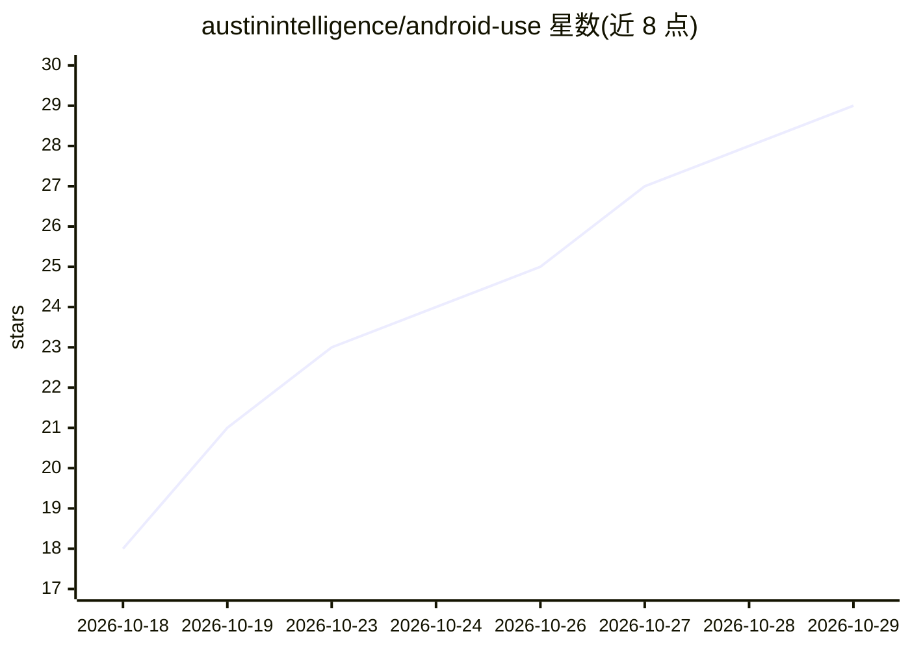

# austinintelligence/android-use

⭐ 29 · Rust · MIT · 推送 2026-10-25 · [GitHub](https://github.com/austinintelligence/android-use) · [官网](https://www.npmjs.com/package/android-use) · 组织维护

**给 AI agent 提供真实 Android 设备/模拟器受控操作的 MCP 服务器与 CLI**

由设备端辅助 App（经 Android 无障碍服务读屏并执行动作）与电脑端 `au` 程序组成，通过 ADB 通信，向 Claude Code、Codex、Cursor 等 agent 暴露 android_read/android_act 两个 MCP 工具，用自然语言命令完成打开应用、点按、输入、驱动 Chrome 等操作。安全机制包括 policy.toml 策略限制、密钥存系统密钥库且 agent 不可见、手机端审批、单设备绑定与加密质询。不含 AI 模型。需 Android 8+ 与 USB 调试，无需 root。

## 筛选速览

| 维度 | 判定 | 备注 |
|---|---|---|
| AI 角色 | `ai-ecosystem` | LLM/agent 周边工具 |
| 许可风险 | `permissive` | MIT |
| 部署形态 | `desktop` | 安装包/桌面程序 |
| 模型依赖 | — | README 未给出锁定关系 |
| 硬件要求 | — | 无带数字的原话,不猜 |
| 安装摩擦 | `low` | 无编译、无系统依赖或容器化 |
| 成熟度 | — | 结构信号不足 |

## 能力要点

- 两个 MCP 工具：android_read 读屏（文本优先），android_act 执行动作
- policy.toml 控制允许的应用、捕获权限与步数上限
- 密码经系统密钥库输入，agent 不可见；敏感操作在手机端审批
- 会话 trace 可导出为测试（JUnit 输出，支持 CI）

## 适用场景

- 让编码 agent 在真机或模拟器上运行刚构建的应用并留存为测试
- 用自然语言命令完成手机端任务：查设置、读验证码、Chrome 填表
- 在受策略约束下让 agent 自动化操作 Android 应用

## 场景标签

`GUI 自动化` · 领域:效率与自动化

## 证据(README 行号)

> L21: Your agent lives in a terminal and a browser. Most of the apps people use every day live on a phone. android-use co
> L23: There are two pieces. A small helper app on the device reads the screen through Android's accessibility service and
> L149:  Does it include an AI model? No. It gives the agent you already use a compact, checked Android interface.

## 星数曲线

2026-10-18 18 → 2026-10-29 29（+11）

---
*卡片 v1 · prompt 1.4 · 生成 2026-10-27 · 置信度 high · 依据 README sha `09a016271620` · [字段定义](../../DATASET.md)*
