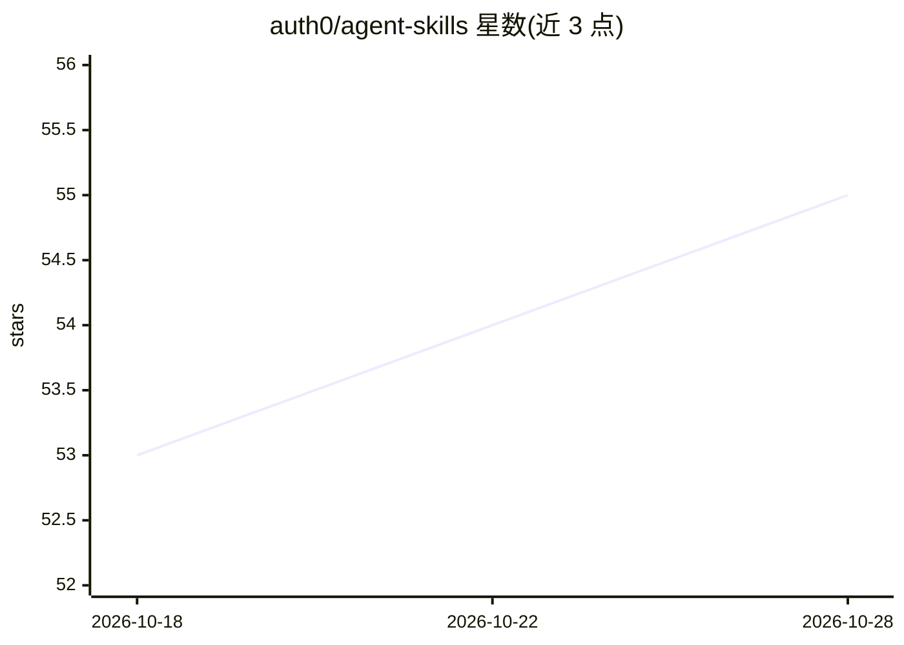

# auth0/agent-skills

⭐ 55 · Python · Apache-2.0 · 推送 2026-10-27 · [GitHub](https://github.com/auth0/agent-skills) · 组织维护

**Auth0 官方 AI 编程助手技能包：指导助手正确接入 Auth0 认证**

Auth0 维护的 Agent Skills 格式技能包，安装到 Claude Code、Cursor、Codex、Gemini CLI、GitHub Copilot 等 40 余种支持该格式的编程助手后，当用户要求添加 Auth0 登录时，技能内的路由器读取项目文件（package.json、requirements.txt 等）检测所用框架，加载对应参考文档，指导助手安装正确 SDK、创建认证路由并配置登录登出。单个 auth0 技能覆盖 Web、移动、桌面与 API 认证共 30 余个框架/SDK 组合，并支持从 Firebase、Cognito、Supabase、Clerk 迁移。旧版按 SDK 拆分的多个技能已合并为单一技能。

## 筛选速览

| 维度 | 判定 | 备注 |
|---|---|---|
| AI 角色 | `ai-knowledge` | 知识聚合/清单类 |
| 许可风险 | `permissive` | Apache-2.0 |
| 部署形态 | `library` | 以包/库形式分发 |
| 模型依赖 | — | README 未给出锁定关系 |
| 硬件要求 | — | 无带数字的原话,不猜 |
| 安装摩擦 | `low` | 无编译、无系统依赖或容器化 |
| 成熟度 | — | 结构信号不足 |

## 能力要点

- 单一 auth0 技能通过路由器自动检测框架并加载对应参考文档
- 覆盖 30 余个框架/SDK 组合的认证接入指导（React、Next.js、Spring Boot、Flutter、.NET 等）
- 提供 MFA（TOTP/SMS/WebAuthn 等）与 ACUL 自定义登录页生成指导
- 支持从 Firebase、Cognito、Supabase、Clerk 或自定义认证迁移

## 适用场景

- 让 AI 编程助手在我的项目中正确接入 Auth0 登录
- 为 Express/FastAPI 等 API 添加 Auth0 JWT 校验
- 从 Firebase Auth 或 Cognito 迁移到 Auth0 时获得分步指导

## 场景标签

`提示工程` · 领域:Agent 开发

## 证据(README 行号)

> L7: AI agent skills that help coding assistants implement Auth0 authentication correctly. Works with Claude Code, Cursor
> L105: 1. Loads the single `auth0` skill, whose **router** reads your project files (`package.json`, `requirements.txt`, 
> L106: 2. Detects your framework and loads the matching reference files (e.g., the Next.js reference for a Next.js projec

## 星数曲线

2026-10-18 53 → 2026-10-28 55（+2）

---
*卡片 v1 · prompt 1.4 · 生成 2026-10-24 · 置信度 high · 依据 README sha `9a3669b5347f` · [字段定义](../../DATASET.md)*
