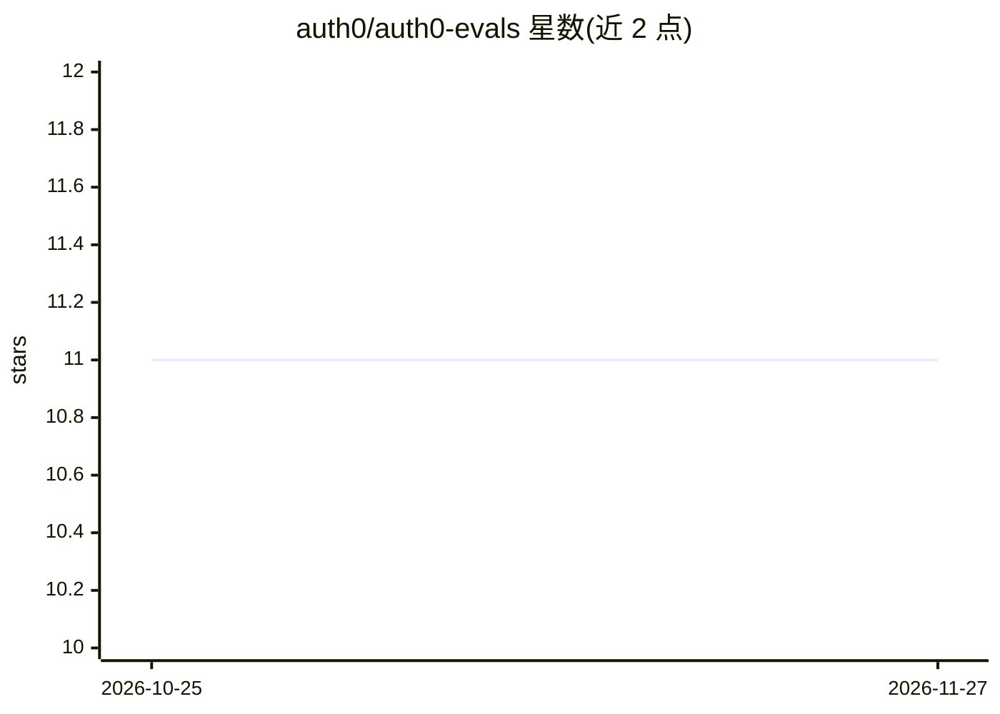

# auth0/auth0-evals

⭐ 11 · TypeScript · Apache-2.0 · 推送 2026-11-26 · [GitHub](https://github.com/auth0/auth0-evals) · 组织维护

**评测 AI agent 完成 Auth0 集成任务准确率的框架**

Auth0 维护的评估框架：为 LLM agent 定义任务 prompt 与判分器，同一任务在 5 种配置（baseline 单次调用至 agent+MCP+skills 完整循环）下运行并比较差值，按 8 维度评分输出 JSON 与 HTML 报告。agent 运行器支持 Claude Code、Copilot、Gemini CLI，也可经 AXIS 框架跨多 agent 一轮运行。README 明确声明为其内部用途开发，不提供对外支持与稳定性承诺。

## 筛选速览

| 维度 | 判定 | 备注 |
|---|---|---|
| AI 角色 | `ai-ecosystem` | LLM/agent 周边工具 |
| 许可风险 | `permissive` | Apache-2.0 |
| 部署形态 | `library` | 以包/库形式分发 |
| 模型依赖 | — | README 未给出锁定关系 |
| 硬件要求 | — | 无带数字的原话,不猜 |
| 安装摩擦 | `low` | 无编译、无系统依赖或容器化 |
| 成熟度 | — | 结构信号不足 |

## 能力要点

- 同一任务跨 5 种配置（baseline/agent/+skills/+mcp）运行并比较差值
- 8 维度评分（流程+输出质量），HTML 报告与 leaderboard
- 支持 Claude Code/Copilot/Gemini CLI 三种 agent 运行器
- AXIS 多 agent 框架集成，含 4 维 LLM judge

## 适用场景

- 量化 skills/MCP 等投入对 agent 集成 Auth0 任务的效果
- 为内部 agent 工具链建立可复现的基准测试
- 生成多 agent 跨框架的评测对比报告

## 场景标签

`模型评测` · 领域:评测与运维

## 证据(README 行号)

> L3: An evaluation framework for measuring how accurately LLM agents complete Auth0 integration tasks. It runs each task 
> L9: We use `auth0-evals` to measure how well AI agents integrate Auth0 across our SDKs, MCP servers, and skills - and to

## 星数曲线

2026-10-25 11 → 2026-11-27 11（+0）

---
*卡片 v1 · prompt 1.4 · 生成 2026-11-18 · 置信度 high · 依据 README sha `166d72307700` · [字段定义](../../DATASET.md)*
