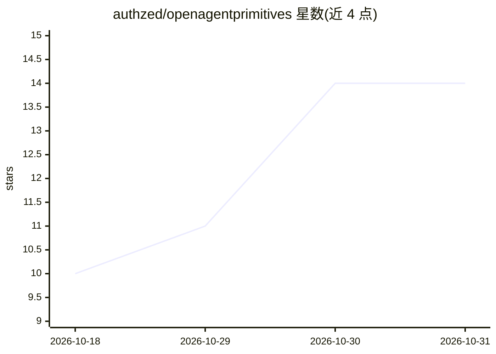

# authzed/openagentprimitives

⭐ 14 · Go · Apache-2.0 · 推送 2026-10-30 · [GitHub](https://github.com/authzed/openagentprimitives) · [官网](openap.org) · 组织维护

**企业 AI agent 安全运行框架：动作级授权与提示注入防护**

构建与运行企业 agent 的构件集合，定义六个原语：agent 定义、安全工具、身份与凭据、授权、通道连续性、记忆知识。核心机制是把控制点放在模型之外：每个动作（工具调用、记忆访问、偏好）都对照镜像组织所有权的关系图授权；通过计划门控、资源槽位、平台生成的审批描述来约束注入指令的影响；工具在隔离沙箱运行并单独注入凭据；审计日志签名哈希链化并可离线校验。运行于自有 Kubernetes 集群或本地 macOS 桌面 VM，模型可在 Anthropic/OpenAI/OpenRouter 间切换。

## 筛选速览

| 维度 | 判定 | 备注 |
|---|---|---|
| AI 角色 | `ai-ecosystem` | LLM/agent 周边工具 |
| 许可风险 | `permissive` | Apache-2.0 |
| 部署形态 | `library` | 以包/库形式分发 |
| 模型依赖 | locked-api |  |
| 硬件要求 | — | 无带数字的原话,不猜 |
| 安装摩擦 | `low` | 无编译、无系统依赖或容器化 |
| 成熟度 | — | 结构信号不足 |

## 能力要点

- 27 项安全控制，按动作对照关系图授权，失败检查可转审批请求
- 计划门控与资源槽位：注入指令不能扩大已授权范围
- 审计日志签名、哈希链化，oap audit verify 可离线校验
- 工具沙箱隔离与按工具注入凭据，模型不可见

## 适用场景

- 在生产 Kubernetes 中运行持有生产凭据的企业 agent
- 需要按组织关系做细粒度授权与审批的 agent 部署
- 对 agent 会话做防篡改审计与离线核验
- 在 Slack/GitHub/CLI 等通道中让团队使用受控 agent

## 场景标签

`Agent 框架` `网络安全` · 领域:Agent 开发

## 证据(README 行号)

> L7: OAP is a set of building blocks for constructing and running enterprise agents.
> L45: Every control in OAP therefore sits outside the model. The platform decides
> L157: - **You choose the model.** Anthropic, OpenAI, or OpenRouter, swappable per

## 星数曲线

2026-10-18 10 → 2026-10-31 14（+4）

---
*卡片 v1 · prompt 1.4 · 生成 2026-10-31 · 置信度 mid · 依据 README sha `09882c0ae95b` · [字段定义](../../DATASET.md)*
