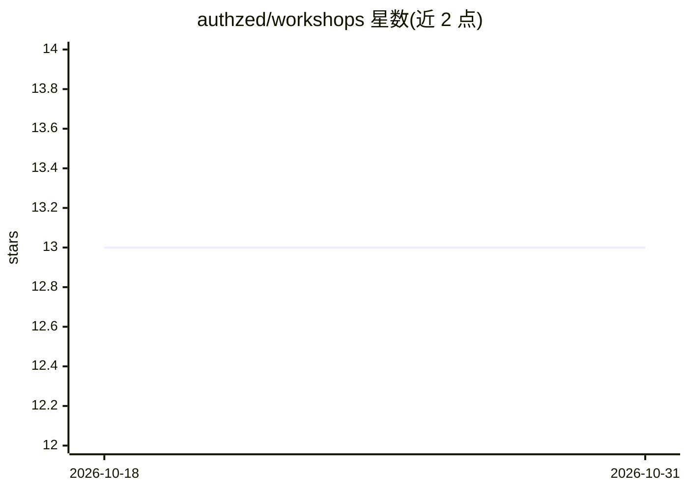

# authzed/workshops

⭐ 13 · Python · 推送 2026-10-14 · [GitHub](https://github.com/authzed/workshops) · 组织维护

**SpiceDB 细粒度授权的动手自学工坊集合**

AuthZed 维护的自导式实践教程仓库，围绕 SpiceDB 细粒度授权提供多个工坊：为 Agentic RAG 系统加权限检查、给 AI Agent 做时限授权与即时撤销、RAG 管道的前置/后置过滤防泄漏、按权限渲染 Web 界面，以及用 MCP 构建授权模型。每个工坊本地运行并产出可工作代码，技术栈涉及 SpiceDB、Milvus/Qdrant、LangGraph、Docker、Next.js 等。不要求授权背景，需终端、Python 与 Docker 基础。

## 筛选速览

| 维度 | 判定 | 备注 |
|---|---|---|
| AI 角色 | `ai-knowledge` | 知识聚合/清单类 |
| 许可风险 | `none` | — |
| 部署形态 | `None` |  |
| 模型依赖 | — | README 未给出锁定关系 |
| 硬件要求 | — | 无带数字的原话,不猜 |
| 安装摩擦 | `low` | 无编译、无系统依赖或容器化 |
| 成熟度 | — | 结构信号不足 |

## 能力要点

- 5 个本地运行的授权实践工坊，每个产出可工作代码
- 覆盖 Agentic RAG 防泄漏、Agent 委托授权、RAG 前置/后置过滤场景
- 不假设授权背景，先展示泄漏问题再修复

## 适用场景

- 为 RAG 或 AI Agent 系统学习细粒度授权实现
- 跟随工坊动手搭建带权限检查的应用
- 了解 MCP 在授权建模中的用法

## 场景标签

`教程课程` · 领域:学习与行业

## 证据(README 行号)

> L3: Self-guided, hands-on workshops for fine-grained authorization with SpiceDB. Each one runs locally, builds something
> L7: |**Building Authorization for Agentic RAG Systems**|Watch an agentic RAG leak documents across departments, then add
> L17: Start with **Secure Your RAG Pipelines** or **Building Authorization for Agentic RAG Systems**. Both open with a wo

## 星数曲线

2026-10-18 13 → 2026-10-31 13（+0）

---
*卡片 v1 · prompt 1.4 · 生成 2026-10-31 · 置信度 high · 依据 README sha `9d0e8d622567` · [字段定义](../../DATASET.md)*
