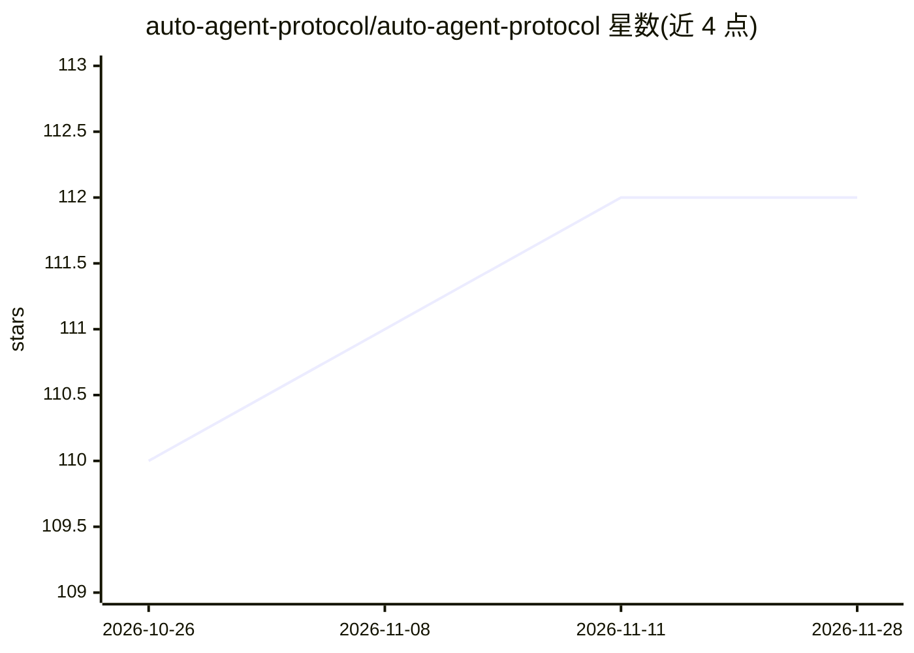

# auto-agent-protocol/auto-agent-protocol

⭐ 112 · TypeScript · NOASSERTION · 推送 2026-11-19 · [GitHub](https://github.com/auto-agent-protocol/auto-agent-protocol) · [官网](https://autoagentprotocol.org/) · 组织维护

**汽车经销商与买家 Agent 之间的开放契约规范（MCP/A2A/PAP）**

一份面向汽车零售场景的开放协议规范：定义经销商发现（Agent Card/Poppy 文档/llms.txt）、库存搜索、车辆事实与价格核验、带用户同意的询价提交等 5 项核心技能与 2 项可选技能（置换估价、信贷申请），并给出 MCP、A2A 1.0、PAP 1.0 三种接口的原生绑定。规范以 JSON Schema 2020-12、TypeScript 类型与运行时校验器包发布，附带 MCP 工具目录 mcp.json 与 OpenAPI 描述文件。协议不要求经销商侧部署语言模型或更换 CRM；支付、下单、约束性报价在范围之外。4.0 为要求 PAP 客户端迁移的大版本。

## 筛选速览

| 维度 | 判定 | 备注 |
|---|---|---|
| AI 角色 | `ai-ecosystem` | LLM/agent 周边工具 |
| 许可风险 | `none` | NOASSERTION |
| 部署形态 | `library` | 以包/库形式分发 |
| 模型依赖 | — | README 未给出锁定关系 |
| 硬件要求 | — | 无带数字的原话,不猜 |
| 安装摩擦 | `low` | 无编译、无系统依赖或容器化 |
| 成熟度 | — | 结构信号不足 |

## 能力要点

- 同一汽车契约在 MCP、A2A 1.0、PAP 1.0 三种接口下原生运行
- 经销商域名通过 Agent Card、Poppy 文档与 llms.txt 发布发现信息
- 提供 JSON Schema、TypeScript 类型与运行时校验器三个 npm 包
- 5 项核心技能与 2 项可选技能，询价需显式同意与幂等键

## 适用场景

- 让买家 Agent 发现经销商并搜索真实库存
- 按规范提交经用户同意的询价或预约请求
- 经销商对外发布符合契约的 MCP/A2A/PAP 端点

## 场景标签

`Agent 框架` · 领域:Agent 开发

## 证据(README 行号)

> L9: **One open automotive contract for MCP, A2A and Personal Agent Protocol.** Discover dealerships, search real invento
> L23: A full AAP 4.0 dealer deployment serves its implemented skill subset through all three. A buyer client needs only i

## 星数曲线

2026-10-26 110 → 2026-11-28 112（+2）

---
*卡片 v1 · prompt 1.4 · 生成 2026-11-28 · 置信度 high · 依据 README sha `ad7b35a04190` · [字段定义](../../DATASET.md)*
