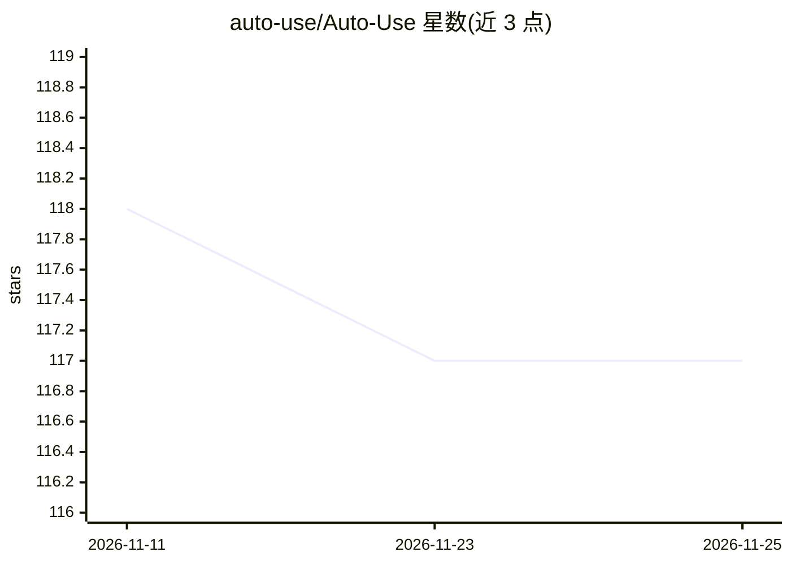

# auto-use/Auto-Use

⭐ 117 · Python · Apache-2.0 · 推送 2026-07-26 · [GitHub](https://github.com/auto-use/Auto-Use) · [官网](https://autouse.netlify.app/) · 个人维护

**让 AI 用自然语言操控电脑的桌面/浏览器自动化框架**

面向 macOS 与 Windows 的 Computer Use 框架：通过 Accessibility 树提取、标注截图与视觉模型调度三者结合，让多模态 LLM 操控系统 GUI、浏览器与终端。采用多智能体层级（Parent/CLI Agent/只读 Minion 子代理），内建 AppleScript 执行与 TCC 弹窗处理、沙箱化 Bash（路径封锁与超时）、Perplexity Sonar 网页搜索。支持 6 家 LLM 提供商按任务切换。提供官网一键安装包，开发者亦可从源码经 setup 脚本运行；需自备 API key，macOS 需授予完全磁盘访问权限。

## 筛选速览

| 维度 | 判定 | 备注 |
|---|---|---|
| AI 角色 | `ai-ecosystem` | LLM/agent 周边工具 |
| 许可风险 | `permissive` | Apache-2.0 |
| 部署形态 | `None` |  |
| 模型依赖 | locked-api |  |
| 硬件要求 | — | 无带数字的原话,不猜 |
| 安装摩擦 | `low` | 无编译、无系统依赖或容器化 |
| 成熟度 | — | 结构信号不足 |

## 能力要点

- Accessibility 树 + 标注截图的混合 GUI 控制方式
- Parent/CLI Agent/只读 Minion 多智能体层级，子代理可无限派生
- 沙箱化 Bash 与 AppleScript 引擎（自动处理 TCC 权限弹窗）
- 支持 Anthropic、Google、Groq、OpenAI、OpenRouter、Perplexity 6 家提供商

## 适用场景

- 用自然语言让 AI 操作桌面应用完成卸载软件等任务
- 让智能体在浏览器中填表、抓取数据
- 通过 CLI Agent 与并行 Minion 探索并编写代码
- 结合网页搜索完成资料整理与研究任务

## 场景标签

`GUI 自动化` `浏览器自动化` `多智能体` · 领域:Agent 开发

## 证据(README 行号)

> L11:  Let AI drive your computer — **Autouse AI — Computer Use**, now with both the macOS and Windows builds combined in
> L25: - **GUI automation via hybrid Accessibility + Vision** — Quartz screen capture annotated with the macOS Accessibili

## 星数曲线

2026-11-11 118 → 2026-11-25 117（-1）

---
*卡片 v1 · prompt 1.4 · 生成 2026-11-17 · 置信度 mid · 依据 README sha `d56898c4991c` · [字段定义](../../DATASET.md)*
