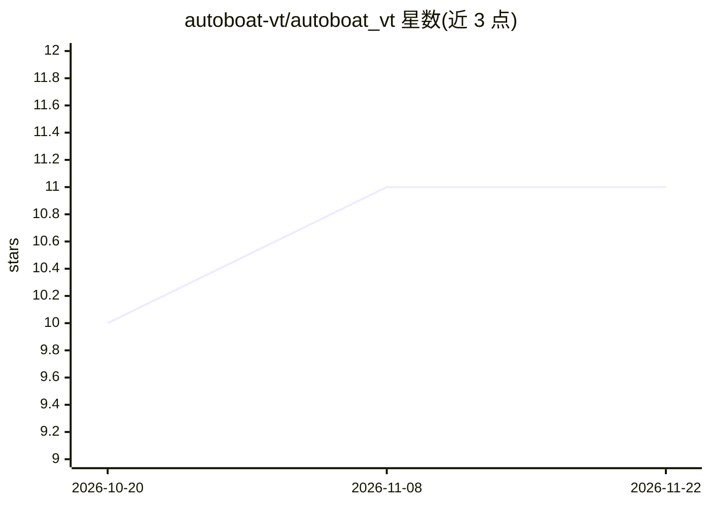

# autoboat-vt/autoboat_vt

⭐ 11 · C++ · GPL-3.0 · 推送 2026-11-20 · [GitHub](https://github.com/autoboat-vt/autoboat_vt) · [官网](https://autoboat-vt.github.io/documentation) · 组织维护

**弗吉尼亚理工 AutoBoat 自主水面艇软件主仓库**

弗吉尼亚理工 AutoBoat 团队的自主水面艇主软件包，涵盖自主导航、电机控制与机器学习相关模块，基于 ROS2 与 micro-ROS 构建，GUI 使用 PySide6。README 本体极简，文档与安装说明托管在独立站点，部署时通过脚本安装预构建二进制，并提供 BibTeX 引用条目供研究使用。

## 筛选速览

| 维度 | 判定 | 备注 |
|---|---|---|
| AI 角色 | `ai-native` | 本体是模型或模型工具 |
| 许可风险 | `viral` | GPL-3.0 |
| 部署形态 | `None` |  |
| 模型依赖 | — | README 未给出锁定关系 |
| 硬件要求 | — | 无带数字的原话,不猜 |
| 安装摩擦 | `low` | 无编译、无系统依赖或容器化 |
| 成熟度 | — | 结构信号不足 |

## 能力要点

- 提供预构建二进制的一键安装脚本
- 基于 ROS2/micro-ROS 的机器人软件栈
- 提供 BibTeX 学术引用条目
- 独立文档站点承载完整安装说明

## 适用场景

- 部署 AutoBoat 自主水面艇的船载软件
- 作为机器人/自主导航项目的代码基础进行引用
- 搭建 ROS2 无人艇开发环境

## 场景标签

 · 领域:机器人/自主系统

## 证据(README 行号)

> L1: ## Welcome to the Main Software Package for Virginia Tech AutoBoat
> L19:   title        = {AutoBoat VT - Main Software Package for the Virginia Tech AutoBoat Autonomous Surface Vessel Team

## 星数曲线

2026-10-20 10 → 2026-11-22 11（+1）

---
*卡片 v1 · prompt 1.4 · 生成 2026-11-18 · 置信度 mid · 依据 README sha `260e42d6a5e9` · [字段定义](../../DATASET.md)*
