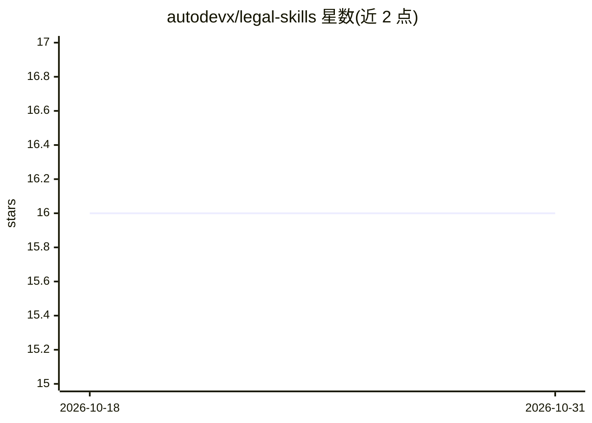

# autodevx/legal-skills

⭐ 16 · Python · MIT · 推送 2026-10-23 · [GitHub](https://github.com/autodevx/legal-skills) · [官网](https://github.com/autodevx) · 组织维护

**巴西法律业务 Claude 技能集：CNJ 解析、合同审查、或有负债报告**

面向巴西法律部门、财务控制与 Legal Ops 团队的 Claude Desktop 兼容技能集合，包含 4 个已交付技能：CNJ 格式案件编号校验与解析、巴西合同问题条款分析、法律或有负债报告生成（CPC 25 + IAS 37）、听证公告分类。每个技能由 SKILL.md 指令、法律参考资料、Python 辅助脚本（无外部依赖）与 pytest 测试构成。可通过 Claude Desktop、skills.sh 或直接运行脚本使用；另有 10 个技能处于开发或规划状态。由 Autodev Tecnologia 维护，MIT 许可。

## 筛选速览

| 维度 | 判定 | 备注 |
|---|---|---|
| AI 角色 | `ai-ecosystem` | LLM/agent 周边工具 |
| 许可风险 | `permissive` | MIT |
| 部署形态 | `None` |  |
| 模型依赖 | — | README 未给出锁定关系 |
| 硬件要求 | — | 无带数字的原话,不猜 |
| 安装摩擦 | `low` | 无编译、无系统依赖或容器化 |
| 成熟度 | `idea` | |

## 能力要点

- 4 个已交付技能：cnj-parser、contrato-review、contingencia-report、audiencia-classifier
- Python 辅助脚本无外部依赖，支持 CLI 与批量处理
- 技能结构含 SKILL.md、法律参考资料、脚本与 pytest 测试
- 兼容 Claude Desktop 与 skills.sh，也可直接运行脚本

## 适用场景

- 校验并解析 CNJ 格式的巴西案件编号
- 分析巴西合同并标出问题条款
- 为财务报告生成法律或有负债报告（CPC 25 + IAS 37）
- 按类型与形式分类听证公告

## 场景标签

`文档解析` `AI 写作` · 领域:内容生成

## 证据(README 行号)

> L11: Um conjunto de skills compatíveis com Claude Desktop e skills.sh para automatizar tarefas do dia a dia de **departa
> L73: ├── SKILL.md          ← Instruções e framework (lido pelo Claude)

## 星数曲线

2026-10-18 16 → 2026-10-31 16（+0）

---
*卡片 v1 · prompt 1.4 · 生成 2026-10-30 · 置信度 high · 依据 README sha `72aafccc1849` · [字段定义](../../DATASET.md)*
