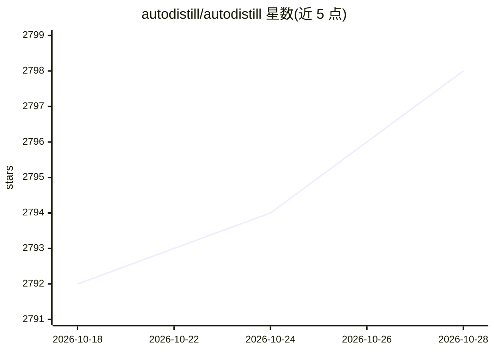

# autodistill/autodistill

⭐ 2,797 · Python · Apache-2.0 · 推送 2026-09-29 · [GitHub](https://github.com/autodistill/autodistill) · [官网](https://docs.autodistill.com) · 组织维护

**用基础模型自动标注图像并蒸馏训练小模型的开源框架**

面向计算机视觉开发者的自动标注与模型蒸馏框架：将无标注图像输入基础模型（Base Model，如 GroundedSAM、Grounding DINO），按 Ontology 提示词自动生成带标注数据集，再训练小型监督模型（Target Model，如 YOLOv8、DETR）得到可部署到云或边缘的蒸馏模型，全程无需人工标注。核心机制为可插拔的 Base/Target Model 插件接口，支持目标检测、实例分割，分类部分列为计划支持；可在自有硬件运行，也可使用 Roboflow 托管版本。限制：README 自述基础模型能力尚未完善，部分组合仍在开发中。

## 筛选速览

| 维度 | 判定 | 备注 |
|---|---|---|
| AI 角色 | `ai-ecosystem` | LLM/agent 周边工具 |
| 许可风险 | `permissive` | Apache-2.0 |
| 部署形态 | `library` | 以包/库形式分发 |
| 模型依赖 | — | README 未给出锁定关系 |
| 硬件要求 | — | 无带数字的原话,不猜 |
| 安装摩擦 | `low` | 无编译、无系统依赖或容器化 |
| 成熟度 | `idea` | |

## 能力要点

- 基础模型自动标注数据集并训练小模型，无需人工标注
- 可插拔的 Base Model / Target Model 插件架构
- 支持 GroundedSAM、Grounding DINO 等 10+ 基础模型与 YOLOv8/DETR 等目标模型组合
- 提供 autodistill 命令行单命令完成标注与训练

## 适用场景

- 我有大量无标注图像，想省去人工标注直接训练检测模型
- 用大基础模型的知识蒸馏出可在边缘实时运行的小模型
- 快速试验不同提示词下的自动标注与模型训练效果

## 场景标签

`目标检测` `微调` · 领域:感知与多模态

## 证据(README 行号)

> L16: Autodistill uses big, slower foundation models to train small, faster supervised models. Using `autodistill`, you c
> L56: To use `autodistill`, you input unlabeled data into a Base Model which uses an Ontology to label a Dataset that is 

## 星数曲线

2026-10-18 2,792 → 2026-10-28 2,798（+6）

---
*卡片 v1 · prompt 1.4 · 生成 2026-10-21 · 置信度 high · 依据 README sha `45f253bbecd9` · [字段定义](../../DATASET.md)*
