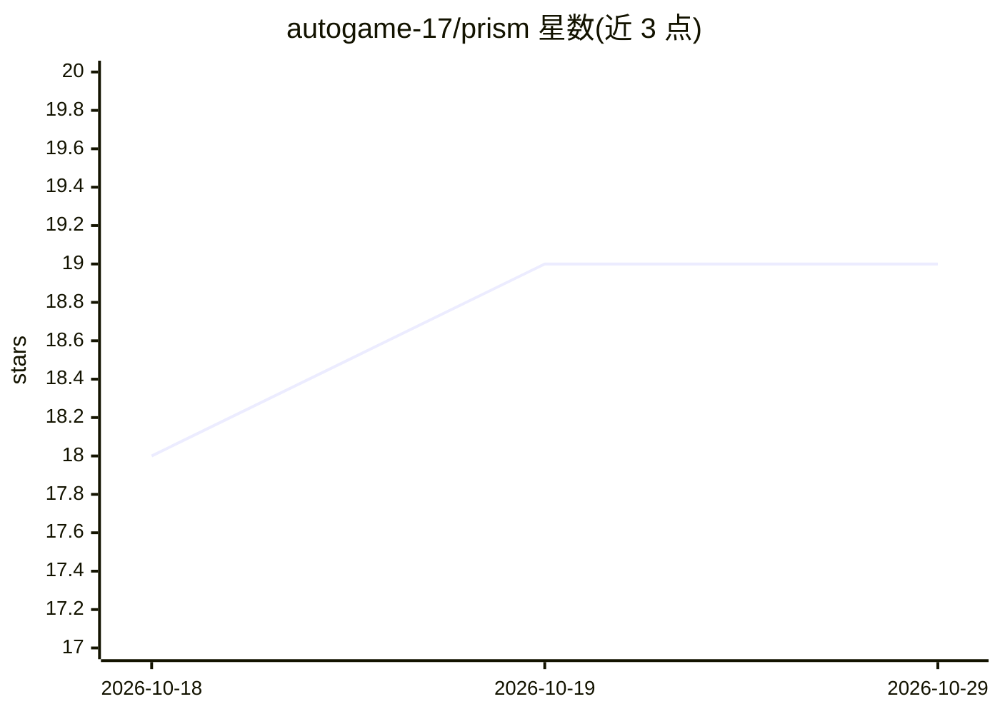

# autogame-17/prism

⭐ 19 · Go · AGPL-3.0 · 推送 2026-05-20 · [GitHub](https://github.com/autogame-17/prism) · 个人维护 · 中文 README

**桌面单二进制 LLM 网关：37 家供应商统一为一个 OpenAI 兼容端点**

将 one-hub 网关封装为 Wails（Go + React）桌面应用，网关进程内运行，无需 Docker，对本地暴露一个 OpenAI 兼容 /v1/chat/completions 端点，背后接入 OpenAI、Anthropic、Gemini、Bedrock、DeepSeek 等 37 家供应商。内嵌 cloudflared 二进制，一键生成临时公网 URL。提供渠道/令牌/日志管理与完整请求响应追踪（存 SQLite），并生成 Cursor / Cline / Cherry Studio 的配置片段。macOS/Windows/Linux 提供安装包，发布版未签名。对上游 one-hub 打了工具调用与错误透传等补丁。

## 筛选速览

| 维度 | 判定 | 备注 |
|---|---|---|
| AI 角色 | `ai-ecosystem` | LLM/agent 周边工具 |
| 许可风险 | `viral` | AGPL-3.0 |
| 部署形态 | `desktop` | 安装包/桌面程序 |
| 模型依赖 | locked-api |  |
| 硬件要求 | — | 无带数字的原话,不猜 |
| 安装摩擦 | `low` | 无编译、无系统依赖或容器化 |
| 成熟度 | — | 结构信号不足 |

## 能力要点

- 单二进制内嵌 one-hub 网关，无需 Docker 或独立进程
- 37 家供应商聚合为一个 OpenAI 兼容端点
- 内置 cloudflared，免 Cloudflare 账号一键公网隧道
- 请求/响应完整追踪（含 SSE 流）存 SQLite，可在 UI 查看

## 适用场景

- 让 Cursor / Cline / Cherry Studio 等客户端通过一个 URL 访问多家模型供应商
- 把本地网关临时分享给远程队友或 agent 使用
- 排查供应商返回的异常请求（查看实际上游报文）

## 场景标签

`模型网关` `LLM 可观测性` · 领域:Agent 开发

## 证据(README 行号)

> L3: A desktop app that runs a local LLM gateway on your Mac/Windows/Linux box and exposes it as an OpenAI-compatible end
> L19: Prism wraps the one-hub gateway as a Wails (Go + React) desktop app. The gateway runs in-process — no Docker, no se
> L65: - **Embedded one-hub.** No separate process. The Go binary imports the gateway as a library, registers its routes o

## 星数曲线

2026-10-18 18 → 2026-10-29 19（+1）

---
*卡片 v1 · prompt 1.4 · 生成 2026-10-28 · 置信度 high · 依据 README sha `992447c8c929` · [字段定义](../../DATASET.md)*
