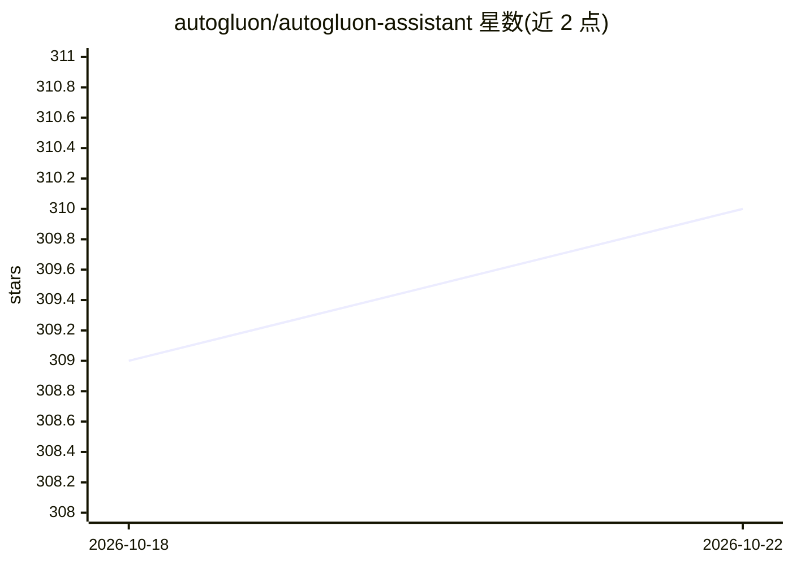

# autogluon/autogluon-assistant

⭐ 310 · Python · Apache-2.0 · 推送 2026-09-01 · [GitHub](https://github.com/autogluon/autogluon-assistant) · 组织维护

**多智能体自动完成端到端多模态机器学习工作流的系统**

AutoGluon Assistant（又名 MLZero）是由多智能体驱动的自动化机器学习系统：将原始多模态数据自动转化为机器学习/深度学习解决方案，号称零人工干预，默认接入 AWS Bedrock 等 LLM 提供商，提供 CLI、Python API、Web UI 与 MCP 多种接口，另有 mlzero chat 对话问答模式。运行中会执行 LLM 生成的代码，官方建议在 Docker 容器中隔离运行；目前仅支持 Linux，最新功能需从源码安装。仓库自述为面向学术研究的实验性代码，非生产就绪。对应论文被 NeurIPS 2025 接收。

## 筛选速览

| 维度 | 判定 | 备注 |
|---|---|---|
| AI 角色 | `ai-ecosystem` | LLM/agent 周边工具 |
| 许可风险 | `permissive` | Apache-2.0 |
| 部署形态 | `self-host` | docker 或自建部署 |
| 模型依赖 | locked-api |  |
| 硬件要求 | — | 无带数字的原话,不猜 |
| 安装摩擦 | `low` | 无编译、无系统依赖或容器化 |
| 成熟度 | `idea` | |

## 能力要点

- 多智能体系统端到端自动化多模态 ML 工作流
- 支持多种 LLM 提供商，默认 AWS Bedrock
- 提供 CLI、Python API、Web UI、MCP 四种接口
- 提供 Docker 镜像构建与运行说明

## 适用场景

- 给原始多模态数据自动产出可用的机器学习方案
- 通过对话模式获取机器学习指导
- 科研场景下复现或扩展 MLZero 多智能体框架

## 场景标签

`多智能体` `科研工具` · 领域:Agent 开发

## 证据(README 行号)

> L10: AutoGluon Assistant (aka MLZero) is a multi-agent system that automates end-to-end multimodal machine learning or d
> L27: - LLM Providers - Using different AI providers (Bedrock, OpenAI, Anthropic, SageMaker)

## 星数曲线

2026-10-18 309 → 2026-10-22 310（+1）

---
*卡片 v1 · prompt 1.4 · 生成 2026-10-21 · 置信度 high · 依据 README sha `604c47ef86e6` · [字段定义](../../DATASET.md)*
