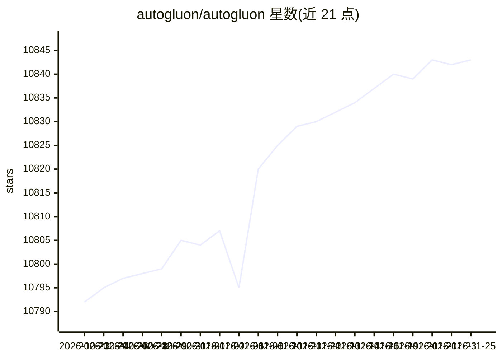

# autogluon/autogluon

⭐ 10,843 · Python · Apache-2.0 · 推送 2026-11-23 · [GitHub](https://github.com/autogluon/autogluon) · [官网](https://auto.gluon.ai/) · 组织维护

**AutoML 库：表格/时序/多模态数据自动建模预测**

AutoGluon 是自动化机器学习库，对表格、时间序列和多模态数据自动完成模型选择与组合训练，几行代码即可训练模型并生成预测。提供 TabularPredictor、TimeSeriesPredictor、MultiModalPredictor 三类任务接口，基于 Python 3.10-3.13，支持 Linux/macOS/Windows，可通过 pip 或 Conda 安装，另提供云端训练部署途径（AWS Cloud、Docker 容器、SageMaker）。维护方接受社区代码贡献，文档采用 Apache 2.0 许可。

## 筛选速览

| 维度 | 判定 | 备注 |
|---|---|---|
| AI 角色 | `ai-native` | 本体是模型或模型工具 |
| 许可风险 | `permissive` | Apache-2.0 |
| 部署形态 | `library` | 以包/库形式分发 |
| 模型依赖 | — | README 未给出锁定关系 |
| 硬件要求 | — | 无带数字的原话,不猜 |
| 安装摩擦 | `low` | 无编译、无系统依赖或容器化 |
| 成熟度 | — | 结构信号不足 |

## 能力要点

- 3 行代码完成端到端模型训练与预测
- 自动搜索最优模型组合，覆盖传统 ML 到基础模型
- 三类预测器：表格、时间序列、多模态
- 提供云端部署途径与官方 Docker 容器

## 适用场景

- 对表格数据快速训练分类/回归模型
- 做时间序列概率预测
- 处理含文本的表格多模态建模
- 在 SageMaker 上托管运行 AutoML 流程

## 场景标签

 · 领域:机器学习/AutoML

## 证据(README 行号)

> L15: AutoGluon automates machine learning on data such as tables and time series, helping you achieve strong predictive 
> L17: From classic ML algorithms to foundation models, the options keep multiplying — but which one should you use? AutoG
> L37: predictor = TabularPredictor(label="class").fit("train.csv", presets="best")

## 星数曲线

2026-10-23 10,792 → 2026-11-25 10,843（+51）

---
*卡片 v1 · prompt 1.4 · 生成 2026-11-22 · 置信度 high · 依据 README sha `5546b8f6d91b` · [字段定义](../../DATASET.md)*
