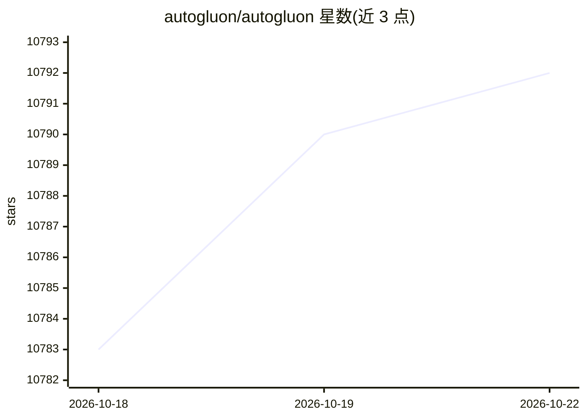

# autogluon/autogluon

⭐ 10,792 · Python · Apache-2.0 · 推送 2026-10-21 · [GitHub](https://github.com/autogluon/autogluon) · [官网](https://auto.gluon.ai/) · 组织维护

**面向表格/多模态/时序数据的自动机器学习框架**

AutoGluon 提供 AutoML 能力：对表格、时序、多模态数据自动训练与调优模型，通过 TabularPredictor、TimeSeriesPredictor、MultiModalPredictor 三个入口，用少量代码（如 3 行）完成训练与预测，并自动搜索模型组合与集成。支持 Python 3.10-3.13，可在 Linux/macOS/Windows 安装，GPU、Conda 与可选依赖另行说明。由 AWS 团队维护，配套云部署方案（Docker 容器、SageMaker Autopilot 等），有多篇论文与教程。

## 筛选速览

| 维度 | 判定 | 备注 |
|---|---|---|
| AI 角色 | `ai-native` | 本体是模型或模型工具 |
| 许可风险 | `permissive` | Apache-2.0 |
| 部署形态 | `library` | 以包/库形式分发 |
| 模型依赖 | — | README 未给出锁定关系 |
| 硬件要求 | — | 无带数字的原话,不猜 |
| 安装摩擦 | `low` | 无编译、无系统依赖或容器化 |
| 成熟度 | — | 结构信号不足 |

## 能力要点

- 表格/时序/多模态三类任务的 Predictor API
- 自动搜索并组合多个模型（含基础模型）
- 提供官方 Docker 容器与云部署选项（SageMaker/DLC）
- Apache 2.0 许可，pip 一行安装

## 适用场景

- 我在 CSV 表格数据上快速训练并得到预测结果
- 我用它做概率式时间序列预测
- 我在含文本/图像的混合表格数据上自动建模

## 场景标签

 · 领域:机器学习/AutoML

## 证据(README 行号)

> L15: AutoGluon automates machine learning on data such as tables and time series, helping you achieve strong predictive 
> L36: from autogluon.tabular import TabularPredictor
> L38: predictions = predictor.predict("test.csv")

## 星数曲线

2026-10-18 10,783 → 2026-10-22 10,792（+9）

---
*卡片 v1 · prompt 1.4 · 生成 2026-10-20 · 置信度 high · 依据 README sha `7446a94f39fa` · [字段定义](../../DATASET.md)*
