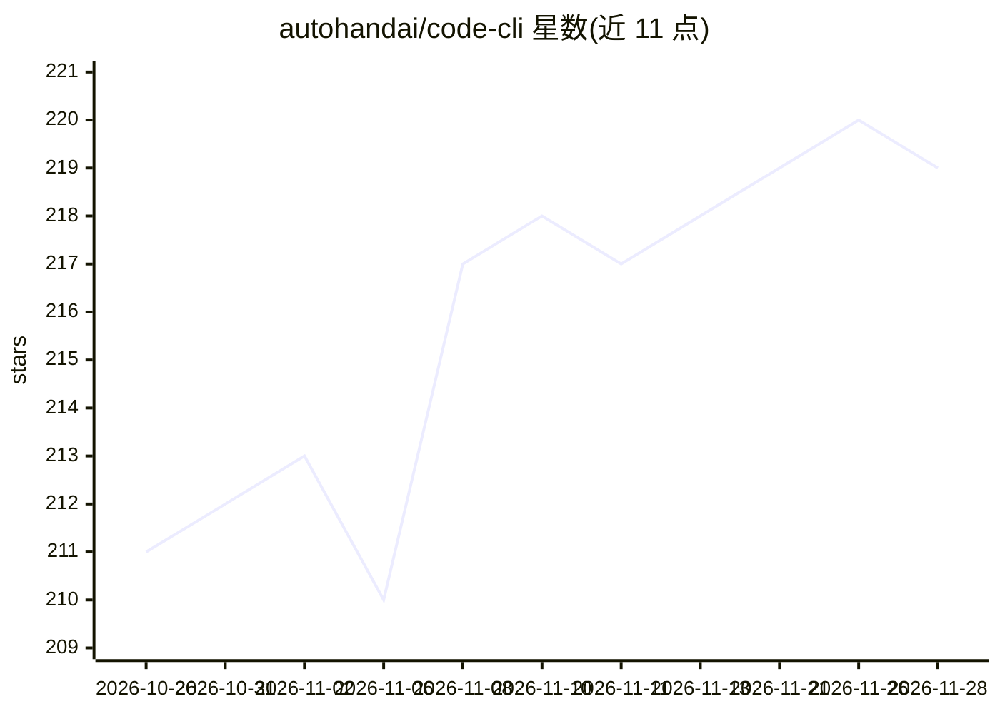

# autohandai/code-cli

⭐ 219 · TypeScript · Apache-2.0 · 推送 2026-11-26 · [GitHub](https://github.com/autohandai/code-cli) · [官网](https://www.autohand.ai/code/) · 组织维护

**终端原生 AI 编码 agent：读代码、规划、编辑、测试并自动化工程任务**

终端中运行的 AI 编码 agent：读取项目上下文、规划变更、编辑文件、执行 shell 命令，并在高风险操作前请求确认。提供交互式 REPL（文件提及、斜杠命令、技能、权限控制、会话历史）与面向 CI/CD 的命令模式（JSON 流输出）。支持 15+ 模型提供商及本地模型，可从 Claude Code 导入设置、技能与会话；附带 VS Code 扩展、Zed/ACP 集成与多语言 Agent SDK。要求 Node.js 22+，跨 macOS/Linux/Windows。安装器会替换 PATH 上的 agent 命令，并附带 ahtraces 与 Computer Use 组件。

## 筛选速览

| 维度 | 判定 | 备注 |
|---|---|---|
| AI 角色 | `ai-native` | 本体是模型或模型工具 |
| 许可风险 | `permissive` | Apache-2.0 |
| 部署形态 | `self-host` | docker 或自建部署 |
| 模型依赖 | local-ok | 支持本地模型 |
| 硬件要求 | — | 无带数字的原话,不猜 |
| 安装摩擦 | `low` | 无编译、无系统依赖或容器化 |
| 成熟度 | — | 结构信号不足 |

## 能力要点

- 终端 REPL 与非交互命令模式，支持 stream-json 事件输出
- 15+ 模型提供商接入，含 Ollama/llama.cpp/MLX 本地模型
- plan/edit/YOLO/auto 模式切换与 --dry-run 预览
- autohand import claude 导入 Claude Code 的设置、技能与记忆

## 适用场景

- 在终端用自然语言让 agent 完成代码修改与测试补充
- 在 CI/CD 脚本中用 --prompt 跑单条自动化编码任务
- 从 Claude Code 迁移已有配置与技能继续使用
- 通过 VS Code/Zed/JetBrains 的集成在编辑器内调用 agent

## 场景标签

`编码 Agent` · 领域:编码与开发

## 证据(README 行号)

> L10: **A fast, self-improving terminal-native AI coding agent for planning, reflecting, remembering, editing, testing, a
> L12: Autohand Code CLI is a fast, terminal-native AI coding agent that lives where you already work. It reads project co
> L34: - **Multi-Provider Support**: Free Fantail model with an Autohand account, or 15+ providers incl. Anthropic, OpenAI

## 星数曲线

2026-10-26 211 → 2026-11-28 219（+8）

---
*卡片 v1 · prompt 1.4 · 生成 2026-11-25 · 置信度 mid · 依据 README sha `74030a1f85e5` · [字段定义](../../DATASET.md)*
