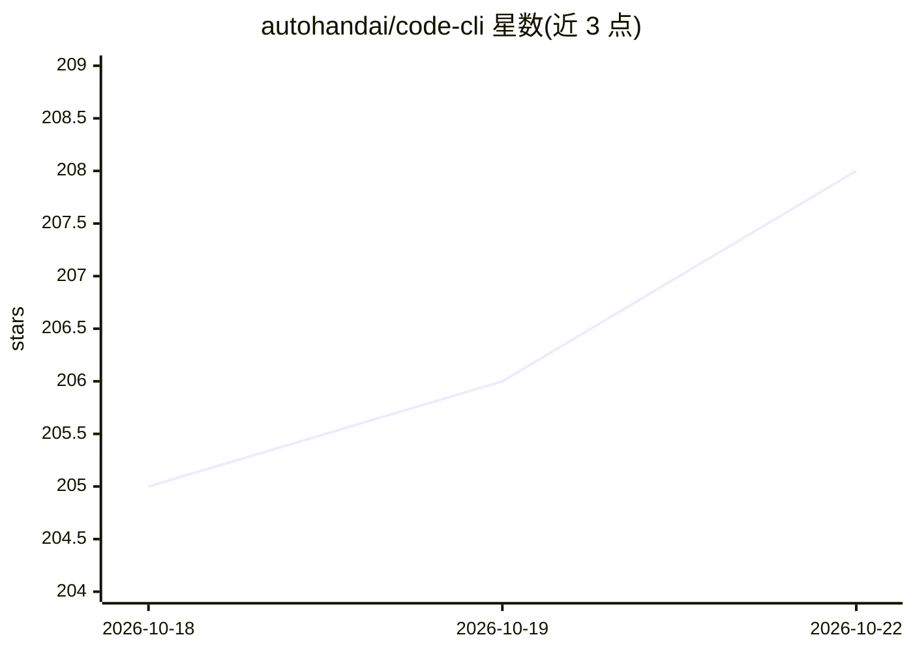

# autohandai/code-cli

⭐ 208 · TypeScript · Apache-2.0 · 推送 2026-10-21 · [GitHub](https://github.com/autohandai/code-cli) · [官网](https://www.autohand.ai/code/) · 组织维护

**终端原生 AI 编程代理：多模型接入下自动规划并改代码**

在终端中运行的 AI 编程代理，读取项目上下文，以规划-反思-记忆循环完成文件编辑、Shell 命令、测试与自动化任务，风险操作前请求批准。支持 OpenRouter、OpenAI、AWS Bedrock、DeepSeek、Z.ai 等多种模型提供商及本地模型，可导入 Claude Code 配置。提供交互式 REPL（斜杠命令、文件提及、技能）与非交互命令模式（stream-json 输出）用于 CI/CD，另有 VS Code/Zed 扩展与多语言 Code Agent SDK。安装方式含脚本、Homebrew、npm 与源码构建，需 Bun≥1.0 与 Git。附带本地追踪组件 ahtraces 与 Computer Use 组件。

## 筛选速览

| 维度 | 判定 | 备注 |
|---|---|---|
| AI 角色 | `ai-native` | 本体是模型或模型工具 |
| 许可风险 | `permissive` | Apache-2.0 |
| 部署形态 | `self-host` | docker 或自建部署 |
| 模型依赖 | local-ok | 支持本地模型 |
| 硬件要求 | — | 无带数字的原话,不猜 |
| 安装摩擦 | `low` | 无编译、无系统依赖或容器化 |
| 成熟度 | `idea` | |

## 能力要点

- 多提供商支持（OpenRouter/OpenAI/Bedrock/DeepSeek/Z.ai）及本地模型
- 规划模式 + 工具循环，风险操作前请求批准
- 非交互命令模式输出 stream-json 事件流，可用于 CI/CD
- Code Agent SDK 提供 TypeScript/Go/Python/Java/Swift 多语言包

## 适用场景

- 在终端用自然语言让 AI 代理修改、测试我的代码库
- 在 CI/CD 流水线中自动执行重复性编码任务
- 通过 SDK 把编码代理能力嵌入自己的工具或编辑器集成

## 场景标签

`编码 Agent` · 领域:编码与开发

## 证据(README 行号)

> L10: **A fast, self-improving terminal-native AI coding agent for planning, reflecting, remembering, editing, testing, a
> L26: - **Multi-Provider Support**: Works with OpenRouter, LLMGateway, OpenAI, AWS Bedrock, DeepSeek, Azure Foundry Model

## 星数曲线

2026-10-18 205 → 2026-10-22 208（+3）

---
*卡片 v1 · prompt 1.4 · 生成 2026-10-22 · 置信度 mid · 依据 README sha `9b39156b7d5d` · [字段定义](../../DATASET.md)*
