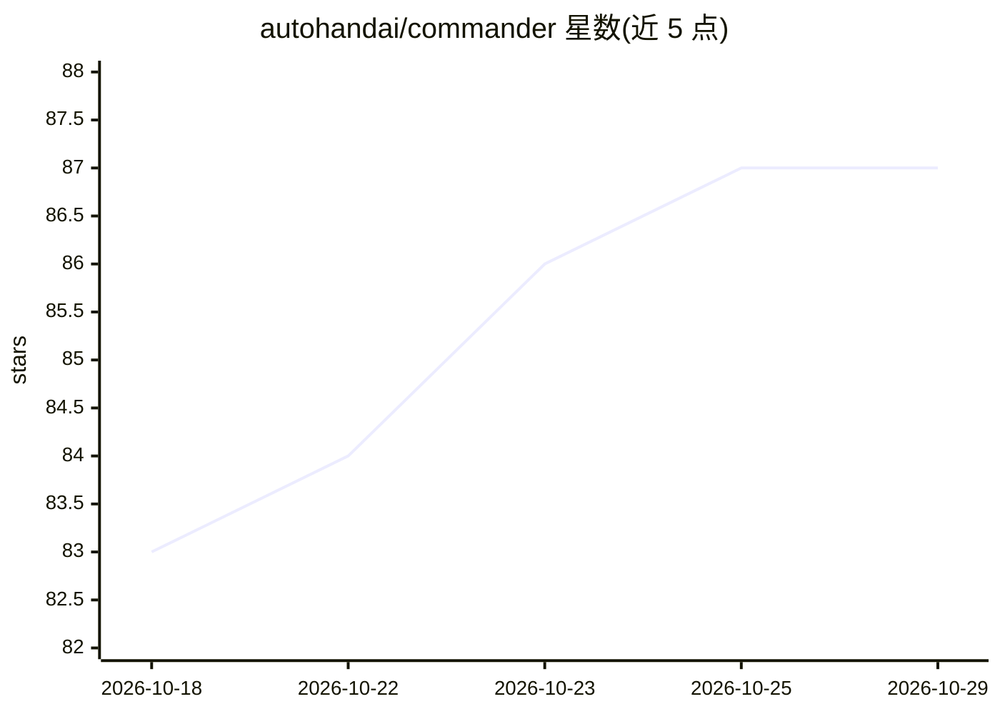

# autohandai/commander

⭐ 87 · TypeScript · 推送 2026-06-09 · [GitHub](https://github.com/autohandai/commander) · [官网](https://www.autohand.ai/commander) · 组织维护

**编排多个 CLI 编码代理的本地 Tauri 桌面端**

基于 Tauri v2 + React/Vite 的原生桌面应用，用于在同一 Git 项目上编排多个 CLI 编码代理（Claude Code、OpenAI Codex、Google Gemini CLI 及本地测试 harness）：提供多代理聊天界面、流式输出与并行会话跟踪；通过 Git worktrees 在 .commander/ 下为每个代理创建隔离工作区；内置克隆仓库、commit DAG 可视化、diff 查看器与设置持久化。所有自动化在本地执行，不上传代码或聊天记录。需 macOS 或 Windows 11，从源码运行（bun/cargo）。

## 筛选速览

| 维度 | 判定 | 备注 |
|---|---|---|
| AI 角色 | `ai-ecosystem` | LLM/agent 周边工具 |
| 许可风险 | `none` | — |
| 部署形态 | `library` | 以包/库形式分发 |
| 模型依赖 | — | README 未给出锁定关系 |
| 硬件要求 | — | 无带数字的原话,不猜 |
| 安装摩擦 | `low` | 无编译、无系统依赖或容器化 |
| 成熟度 | — | 结构信号不足 |

## 能力要点

- 多 CLI 代理聊天界面（Claude Code / Codex / Gemini CLI），支持流式输出与并行会话
- Git worktrees 隔离工作区，代理不触碰主分支
- commit DAG 可视化、diff 查看器与分支/worktree 选择器
- 设置、聊天记录按项目本地持久化，可恢复会话

## 适用场景

- 在多个 AI 编码代理之间并行处理同一仓库的任务
- 让代理在隔离的 Git worktree 中工作，保护主分支
- 在一个桌面端查看提交历史与工作区差异

## 场景标签

`编码 Agent` · 领域:编码与开发

## 证据(README 行号)

> L5: Commander is a native Tauri v2 desktop app that orchestrates multiple CLI coding agents against any Git project. It 
> L8: - Multi-agent chat surface for Claude Code CLI, OpenAI Codex CLI, Gemini CLI, and a local test harness – each with l

## 星数曲线

2026-10-18 83 → 2026-10-29 87（+4）

---
*卡片 v1 · prompt 1.4 · 生成 2026-10-24 · 置信度 mid · 依据 README sha `1314c1659dc7` · [字段定义](../../DATASET.md)*
