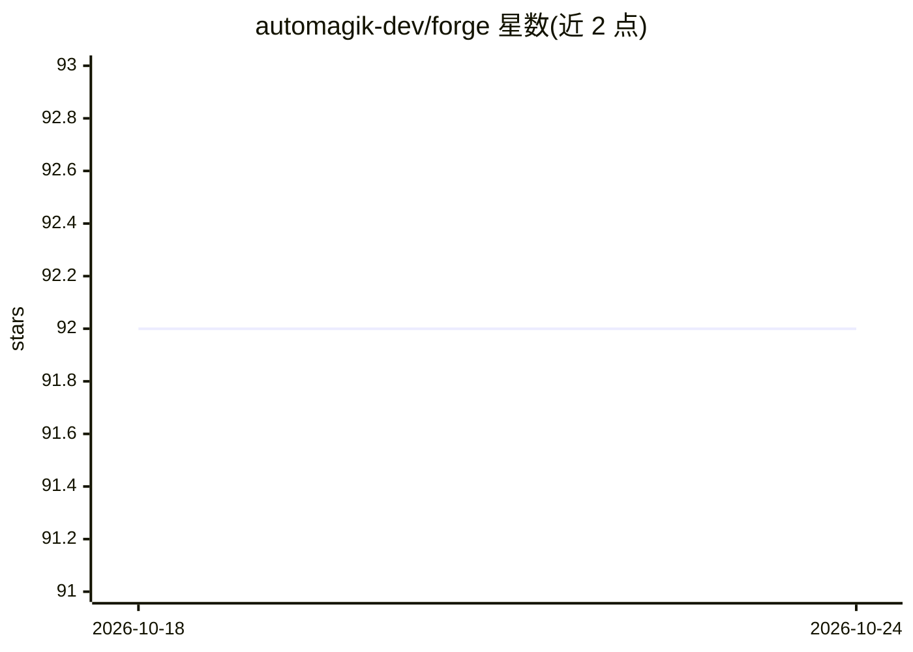

# automagik-dev/forge

⭐ 92 · TypeScript · Apache-2.0 · 推送 2025-12-19 · [GitHub](https://github.com/automagik-dev/forge) · [官网](https://automagik.dev) · 组织维护

**多 AI 编码代理编排平台：看板管理任务，隔离执行多代理尝试**

自托管的人机协作开发平台：任务以持久化看板组织，经 Wish→Forge→Review 三阶段流转；用户为每个任务选择提供方（Claude Code、Cursor、Gemini、Codex、Amp、OpenCode、Qwen Code、Copilot 等 8 种）与自定义代理（test-writer、security-expert 等），每次尝试在独立 Git worktree 中并行执行，可对比多组尝试的 diff 后再合并。内置 MCP Server（50+ 工具）供编码代理远程控制，可选集成 Genie 做 AI 辅助规划。通过 npm 全局安装或 npx 运行，需 Node.js 18+ 与 pnpm 8+，本地浏览器界面运行在 8887 端口。

## 筛选速览

| 维度 | 判定 | 备注 |
|---|---|---|
| AI 角色 | `ai-ecosystem` | LLM/agent 周边工具 |
| 许可风险 | `permissive` | Apache-2.0 |
| 部署形态 | `library` | 以包/库形式分发 |
| 模型依赖 | locked-api |  |
| 硬件要求 | — | 无带数字的原话,不猜 |
| 安装摩擦 | `low` | 无编译、无系统依赖或容器化 |
| 成熟度 | — | 结构信号不足 |

## 能力要点

- 8 种 AI 提供方（Claude Code、Cursor、Gemini、Codex、Amp、OpenCode、Qwen Code、Copilot）
- 每次尝试在独立 Git worktree 中隔离执行，支持多任务并行
- 任务持久化看板与 Wish→Forge→Review 三阶段工作流
- 内置 Forge MCP Server（50+ 工具）与可选 Genie AI 助手集成

## 适用场景

- 在同一看板中管理并对比多个 AI 编码代理的执行结果
- 在隔离环境中并行运行多个代理任务，合并前审查 diff
- 通过 MCP 从现有编码代理中创建和执行任务
- 自托管编排 AI 辅助开发工作流

## 场景标签

`多智能体` `编码 Agent` · 领域:Agent 开发

## 证据(README 行号)

> L120: - **8 AI Providers**: Claude Code, Cursor, Gemini, Codex, and more - including open-source options
> L127: - **MCP Server Built-in**: Control from any AI coding agent without leaving your flow
> L198: Control Forge from your AI coding tools using Model Context Protocol (MCP).

## 星数曲线

2026-10-18 92 → 2026-10-24 92（+0）

---
*卡片 v1 · prompt 1.4 · 生成 2026-10-23 · 置信度 high · 依据 README sha `e4c7f3abe327` · [字段定义](../../DATASET.md)*
