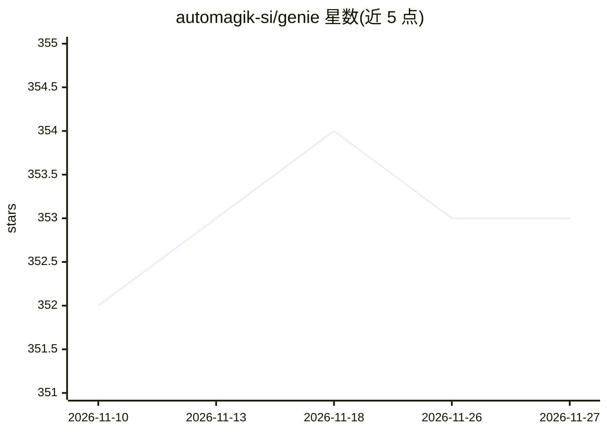

# automagik-si/genie

⭐ 353 · TypeScript · Apache-2.0 · 推送 2026-11-22 · [GitHub](https://github.com/automagik-si/genie) · [官网](https://docs.automagik.dev/genie) · 组织维护

**面向编码 agent 的任务交付框架：一次 /wish 直达可合并 PR**

Genie 是围绕 Claude Code、Codex 等编码 agent 的技能与工作流框架：以 brainstorm→wish→work→review 循环组织任务，每道关卡由未参与编写的 agent 独立评审；设计、计划与评审结论以 markdown 形式存入仓库 git，任务状态存于每仓库一个 SQLite 文件。提供 18 个技能、12 个保存工作流和 18 个 CLI 命令，以签名二进制分发，支持 Linux 与 Apple Silicon macOS，Windows 不支持（WSL2 可用）。README 明确列出不适用场景与成本（如小改动耗时、弱检查下 wish 证明力有限），并给出与 Superpowers、Spec Kit、GSD 的功能对照表。

## 筛选速览

| 维度 | 判定 | 备注 |
|---|---|---|
| AI 角色 | `ai-ecosystem` | LLM/agent 周边工具 |
| 许可风险 | `permissive` | Apache-2.0 |
| 部署形态 | `library` | 以包/库形式分发 |
| 模型依赖 | — | README 未给出锁定关系 |
| 硬件要求 | — | 无带数字的原话,不猜 |
| 安装摩擦 | `low` | 无编译、无系统依赖或容器化 |
| 成熟度 | — | 结构信号不足 |

## 能力要点

- brainstorm→wish→work→review 循环，每道关卡由独立 agent 评审
- 设计与计划以 markdown 存入 git，任务状态存于单个 SQLite 文件（genie board 看板）
- 18 个技能、12 个保存工作流、18 个 CLI 命令
- cosign 签名与 SLSA provenance 的发布验证，genie update 离线校验

## 适用场景

- 把一个已决定的任务交给 /wish，从独立 worktree 产出带评审的 PR
- 让设计与计划留在仓库内，供后续不同 agent 读取同一上下文
- 用 council 技能从多视角压力测试架构或交付决策

## 场景标签

`编码 Agent` `Agent 框架` · 领域:Agent 开发

## 证据(README 行号)

> L8: Give `/wish` one decided task. It checks that the task fits, builds it in its own worktree, runs your repository's o
> L14: Claude Code runs it as `/wish`, Codex as `$wish`, and other agents by name. Docs · Skills · Discord
> L27: Designs and plans stay in your repository as markdown, with the reviews that approved them, so the next agent you u

## 星数曲线

2026-11-10 352 → 2026-11-27 353（+1）

---
*卡片 v1 · prompt 1.4 · 生成 2026-11-17 · 置信度 mid · 依据 README sha `4dde2c2cd072` · [字段定义](../../DATASET.md)*
