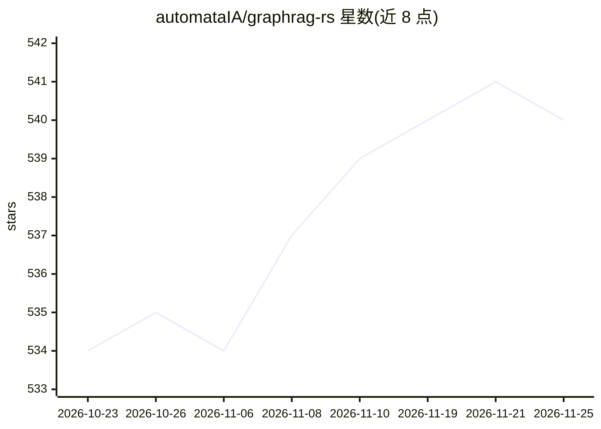

# automataIA/graphrag-rs

⭐ 540 · Rust · MIT · 推送 2026-11-16 · [GitHub](https://github.com/automataIA/graphrag-rs) · [官网](https://automataia.github.io/graphrag-rs/) · 个人维护

**给开发者的 Rust 版 GraphRAG 库：文档建知识图谱并做自然语言检索**

GraphRAG-rs 是 Rust 编写的库与命令行工具，将 UTF-8 文本转为可检索的知识图谱。0.3 主路径为本地运行：使用哈希嵌入、词法检索与基于规则的实体抽取，不依赖 LLM 或网络服务，同步检索结果确定。可选启用 llama.cpp 的 llama-server 或 OpenAI 兼容 API 做抽取与答案生成，另提供 Qdrant、pagerank、persistent-storage 等 feature 的显式 opt-in。需 Rust 1.89+，PDF 不在基础解析路径内，生产检索质量需自行评估。

## 筛选速览

| 维度 | 判定 | 备注 |
|---|---|---|
| AI 角色 | `ai-ecosystem` | LLM/agent 周边工具 |
| 许可风险 | `permissive` | MIT |
| 部署形态 | `library` | 以包/库形式分发 |
| 模型依赖 | — | README 未给出锁定关系 |
| 硬件要求 | — | 无带数字的原话,不猜 |
| 安装摩擦 | `low` | 无编译、无系统依赖或容器化 |
| 成熟度 | — | 结构信号不足 |

## 能力要点

- 本地默认路径无需 LLM 与网络服务，同步检索结果确定
- 可选启用 llama-server 或 OpenAI 兼容 API 做抽取与生成
- 图工作区持久化：保存后跨进程重开，重复索引为更新路径
- 分层配置合并：默认值→config.toml→项目 graphrag.toml→环境变量

## 适用场景

- 将本地文本文档构建为知识图谱并离线检索问答
- 接入 llama.cpp 或 OpenAI 兼容服务增强实体抽取与生成
- 在 Rust 项目中通过 facade crate 集成同步/异步检索 API

## 场景标签

`知识图谱` `RAG` · 领域:知识与检索

## 证据(README 行号)

> L3: GraphRAG-rs is a Rust library and command line tool for turning UTF-8 text into a
> L12: are the maintained 0.3 path. LLM (llama.cpp / OpenAI-compatible) and Qdrant integrations are opt-in and need

## 星数曲线

2026-10-23 534 → 2026-11-25 540（+6）

---
*卡片 v1 · prompt 1.4 · 生成 2026-11-25 · 置信度 high · 依据 README sha `25ceba84874c` · [字段定义](../../DATASET.md)*
