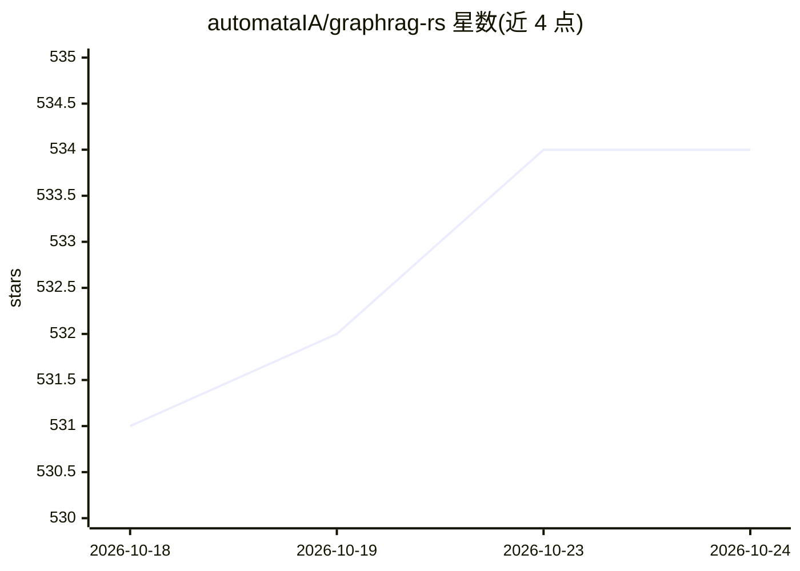

# automataIA/graphrag-rs

⭐ 534 · Rust · MIT · 推送 2026-06-02 · [GitHub](https://github.com/automataIA/graphrag-rs) · [官网](https://automataia.github.io/graphrag-rs/) · 个人维护

**Rust 实现的 GraphRAG 框架：从文档构建知识图谱并用自然语言查询**

用 Rust 编写的模块化 GraphRAG 库与工具集：提供 7 阶段流水线（分块、实体抽取、关系构建、图谱构建、嵌入、检索、生成），从文档构建知识图谱并以自然语言问答。支持 8 种嵌入后端（HuggingFace 默认离线、OpenAI、Ollama 等）、可插拔存储（Qdrant/LanceDB/pgvector/内存），实现 LightRAG、Leiden、HippoRAG 等研究特性。提供 Rust 库、CLI 与 Server-Only、WASM-Only（浏览器端含 WebGPU/ONNX Runtime Web）两种已可用部署形态，Hybrid 形态标注为规划中。面向 Rust 开发者，需 Rust 1.85+ 从源码构建。

## 筛选速览

| 维度 | 判定 | 备注 |
|---|---|---|
| AI 角色 | `ai-ecosystem` | LLM/agent 周边工具 |
| 许可风险 | `permissive` | MIT |
| 部署形态 | `self-host` | docker 或自建部署 |
| 模型依赖 | local-ok | 支持本地模型 |
| 硬件要求 | — | 无带数字的原话,不猜 |
| 安装摩擦 | `low` | 无编译、无系统依赖或容器化 |
| 成熟度 | `idea` | |

## 能力要点

- 7 阶段流水线：分块→实体抽取→图谱构建→嵌入→检索→生成，可配置
- 8 种嵌入后端（HuggingFace 默认免费离线、OpenAI、Ollama 等）
- Server-Only 与 WASM-Only（100% 浏览器端、WebGPU 加速）两种部署形态
- 实现 LightRAG 双层检索、Leiden 社区检测、HippoRAG PageRank 等研究特性
- 提供 CLI（含 setup 向导）、Rust 库 API 与功能束（starter/full/research）

## 适用场景

- 用 CLI 三条命令为本地文档建立知识图谱并问答
- 在 Rust 项目中以库形式嵌入可配置的 GraphRAG 流水线
- 在浏览器端运行隐私优先的文档问答（WASM，无服务器）
- 选择 Ollama 等本地模型做零成本实体抽取与嵌入

## 场景标签

`RAG` `知识图谱` `文档问答` · 领域:知识与检索

## 证据(README 行号)

> L5: A high-performance, modular Rust implementation of GraphRAG (Graph-based Retrieval Augmented Generation) with **thre
> L411: ### Modular Architecture

## 星数曲线

2026-10-18 531 → 2026-10-24 534（+3）

---
*卡片 v1 · prompt 1.4 · 生成 2026-10-21 · 置信度 mid · 依据 README sha `7831d04d0c5a` · [字段定义](../../DATASET.md)*
